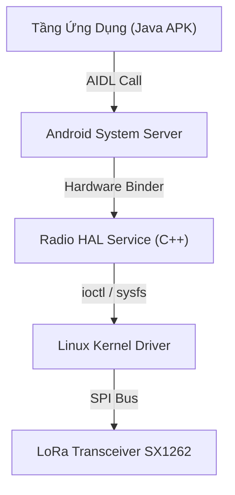
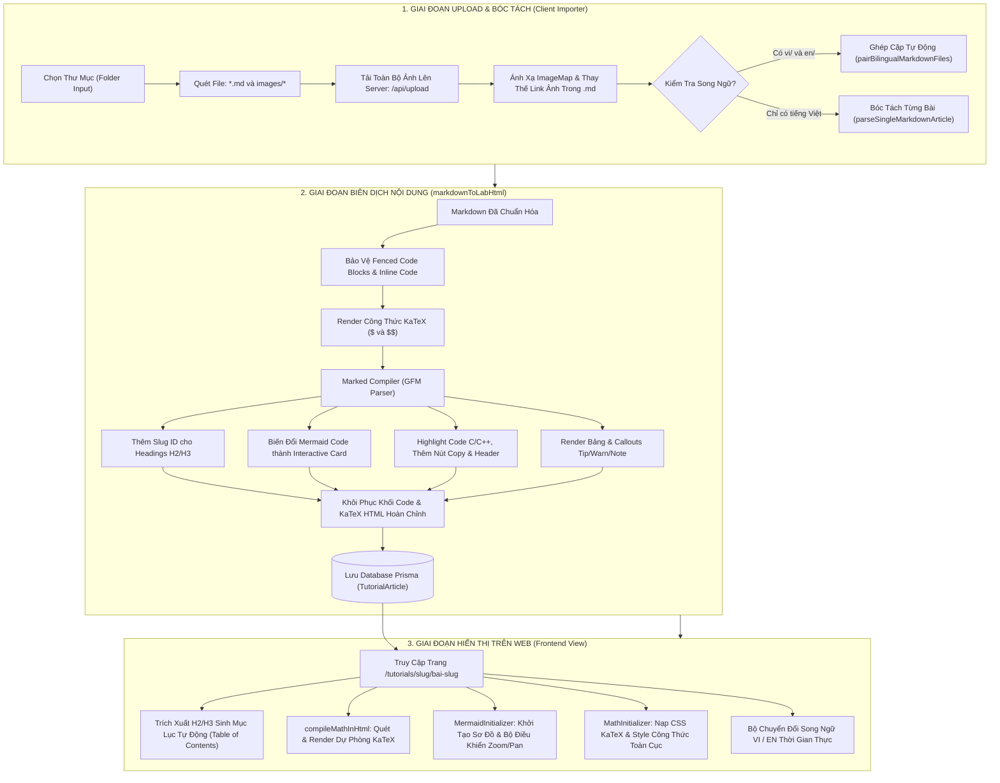

# HƯỚNG DẪN CẤU TRÚC THƯ MỤC MARKDOWN & QUY CHUẨN HIỂN THỊ TRÊN WEB EMBEDDED-AIOT LAB

Tài liệu này hướng dẫn chi tiết cách tổ chức thư mục tài liệu bài giảng định dạng `.md` để sử dụng tính năng **Upload toàn bộ Folder (1-Click Smart Folder Import)** và giải thích chi tiết **kiến trúc render hiển thị** của hệ thống website `embedded-lab-web`.

---

## MỤC LỤC
1. [Cấu Trúc Thư Mục Chuẩn (Standard Folder Layout)](#1-cấu-trúc-thư-mục-chuẩn-standard-folder-layout)
2. [Quy Tắc Đặt Tên File & Tự Động Ghép Cặp Song Ngữ](#2-quy-tắc-đặt-tên-file--tự-động-ghép-cặp-song-ngữ)
3. [Quy Chuẩn Soạn Thảo Nội Dung Trong File .md](#3-quy-chuẩn-soạn-thảo-nội-dung-trong-file-md)
4. [Kiến Trúc Web Render & Xử Lý Hiển Thị](#4-kiến-trúc-web-render--xử-lý-hiển-thị)
5. [Quy Trình Upload Thư Mục Lên Web](#5-quy-trình-upload-thư-mục-lên-web)

---

## 1. CẤU TRÚC THƯ MỤC CHUẨN (STANDARD FOLDER LAYOUT)

Để hệ thống web tự động bóc tách bài học, đồng bộ ảnh, ghép cặp song ngữ (Tiếng Việt & Tiếng Anh) và sắp xếp đúng thứ tự 100%, cấu trúc thư mục của một khóa học / chuyên đề cần được tổ chức như sau:

```text
ten-chuyen-de-mastery/
├── vi/                               # [BẮT BUỘC] Chứa toàn bộ bài giảng Tiếng Việt
│   ├── Bai 01. Tong quan kien truc va so do phan cung.md
│   ├── Bai 02. Quy trinh bootloader va nap he thong.md
│   ├── Bai 03. Bien dich Kernel va Device Tree.md
│   └── ...
├── en/                               # [TÙY CHỌN] Chứa bài giảng Tiếng Anh tương ứng
│   ├── Lesson 01. Architecture Overview and Hardware Schematic.md
│   ├── Lesson 02. Bootloader Workflow and Flashing System.md
│   ├── Lesson 03. Compiling Kernel and Device Tree.md
│   └── ...
├── images/                           # [BẮT BUỘC nếu có ảnh] Thư mục chứa toàn bộ ảnh & sơ đồ
│   ├── bai01_hardware_schematic.svg
│   ├── bai01_block_diagram.png
│   ├── bai02_flash_workflow.svg
│   └── ...
├── labs/                             # [TÙY CHỌN] Chứa mã nguồn thực hành (.c, .h, Makefile, dts...)
│   ├── 01_gpio_driver/
│   │   ├── Makefile
│   │   └── led_driver.c
│   └── ...
└── README.md                         # [TÙY CHỌN] Đề cương/Giới thiệu (Web tự động bỏ qua khi import bài)
```

### Giải thích các thư mục thành phần:
* **`vi/` (Thư mục Tiếng Việt)**: Chứa các tệp Markdown phiên bản tiếng Việt.
* **`en/` (Thư mục Tiếng Anh)**: Chứa các tệp Markdown phiên bản tiếng Anh. Mỗi bài trong thư mục `en/` phải có số thứ tự bài tương ứng với thư mục `vi/`.
* **`images/` (Thư mục Ảnh & Sơ đồ)**: Đặt ngang cấp với `vi/` và `en/`. Định dạng ưu tiên cao nhất là `.svg` (để phóng to không vỡ nét), tiếp theo là `.png`, `.jpg`, `.webp`.
* **`labs/`**: Chứa code thực hành hoàn chỉnh để học viên tải về hoặc tham khảo.
* **`README.md`**: Tệp tổng quan đề cương khóa học. Trình importer thông minh sẽ **tự động bỏ qua** tệp này khi phát hiện có các tệp bài giảng `Bai 01`, `Bai 02`...

---

## 2. QUY TẮC ĐẶT TÊN FILE & TỰ ĐỘNG GHÉP CẶP SONG NGỮ

Hệ thống web sở hữu bộ phân tích nhận dạng thông minh (Heuristic Parser). Để web tự động nhận diện đúng thứ tự và ghép cặp Tiếng Việt - Tiếng Anh:

### 2.1. Quy tắc số thứ tự bài (Lesson Order):
Web dùng biểu thức chính quy (Regex) quét số thứ tự bài học từ tên file:
* **Tiếng Việt (`vi/`)**:
  * Chuẩn khuyến nghị: `Bai 01. Tiêu đề bài viết.md`, `Bai 02. Tiêu đề bài viết.md`
  * Hợp lệ khác: `01-tieu-de.md`, `bai-1.md`, `Chuong 01. ... .md`
* **Tiếng Anh (`en/`)**:
  * Chuẩn khuyến nghị: `Lesson 01. Title of lesson.md`, `Lesson 02. Title of lesson.md`
  * Hợp lệ khác: `01-lesson-title.en.md`, `Chapter 01. ... .md`

### 2.2. Cơ chế ghép cặp song ngữ (Bilingual Pairing):
* Khi bạn nạp folder chứa cả `vi/` và `en/`, web sẽ tự động trích xuất số thứ tự của từng tệp:
  $$\text{vi/Bai 01...} + \text{en/Lesson 01...} \longrightarrow \text{Bài học số 1 (Song ngữ VI + EN)}$$
* Kết quả trên web: Bài viết sẽ có nút chuyển đổi ngôn ngữ nhanh **[VI 🇻🇳]** / **[EN 🇬🇧]**. Người dùng bấm nút là nội dung đổi ngôn ngữ tức thì, không cần tải lại trang!

---

## 3. QUY CHUẨN SOẠN THẢO NỘI DUNG TRONG FILE `.MD`

Để bài viết khi hiển thị trên giao diện web có giao diện hiện đại, chuẩn UI/UX, hỗ trợ mục lục tự động (TOC), sơ đồ tương tác và công thức toán học, hãy tuân thủ các quy tắc sau:

### 3.1. Tiêu đề H1 và Phân cấp đề mục (Heading Hierarchy)
* **# H1 (Duy nhất 1 lần ở đầu file)**: Tên bài viết chính thức.
  ```markdown
  # BÀI 01: TỔNG QUAN KIẾN TRÚC ANDROID BSP VÀ SƠ ĐỒ PHẦN CỨNG RASPBERRY PI 4
  ```
  *(Web sẽ tự động dùng tiêu đề này làm Header bài viết, tạo SEO Meta và tạo đường dẫn URL / slug thân thiện)*.
* **## H2 (Các phần chính)**:
  ```markdown
  ## 1. Phân Tích Kiến Trúc Android AOSP và Linux Kernel
  ## 2. Thiết Kế Mạch Điện Tử Điều Khiển LED
  ```
  *(Web tự động đánh ID slug và đưa toàn bộ mục `## H2` vào Mục lục bài viết ở thanh bên phải)*.
* **### H3 (Các tiểu mục con)**:
  ```markdown
  ### 1.1 Khối Hardware Abstraction Layer (HAL)
  ### 1.2 Giao tiếp Binder IPC Driver
  ```
  *(Web tự động đưa vào mục con thụt lề trong Mục lục phải)*.

> [!WARNING]
> Không nhảy cóc cấp độ heading (ví dụ: từ `## H2` nhảy thẳng xuống `#### H4` mà không có `### H3`), vì sẽ làm vỡ cấu trúc cây mục lục tự động bên phải.

---

### 3.2. Khung tóm tắt bài học (Summary Card - Tùy chọn)
Nếu muốn hiển thị một khung ghi chú tóm tắt nổi bật màu cam ở đầu bài viết:
```markdown
> Tóm tắt: Nắm vững sơ đồ khối phần cứng BCM2711, tính toán điện trở hạn dòng cho LED ngõ ra GPIO và phân tích kiến trúc Driver Android Treble.
```
* **Quy tắc**: Đặt cú pháp `> Tóm tắt: ` hoặc `> Summary: ` ngay bên dưới tiêu đề `# H1`. Viết bằng văn bản thuần túy (Plain Text), không lồng dấu `**`.
* **Cách web xử lý**: Web tự động bóc tách dòng này thành một Widget tóm tắt trực quan ở đầu bài, đồng thời xóa khỏi thân bài để tránh bị trùng lặp văn bản.

---

### 3.3. Hình ảnh và Sơ đồ kỹ thuật (Images & Diagrams)
Trong file `.md`, bạn hãy viết đường dẫn tương đối trỏ tới thư mục `images/`:

```markdown
<p align="center">
  
</p>
```
hoặc cú pháp Markdown tiêu chuẩn:
```markdown

```

> [!IMPORTANT]
> **Điểm ưu việt của Web Importer**:
> Khi bạn chọn nạp cả thư mục, trình duyệt sẽ đọc cả các tệp trong thư mục `images/` và tự động tải chúng lên máy chủ qua `/api/upload`. Sau đó, web **tự động thay thế** toàn bộ các đường dẫn `images/ten_anh.svg` thành URL thực `/uploads/ten_anh.svg`. Bạn không cần phải sửa thủ công bất kỳ đường dẫn nào!

---

### 3.4. Khối mã nguồn mẫu đầu bài (Hero Code Snippet)
Nếu muốn bài viết có một khối mã nguồn mẫu nổi bật hiển thị ở đầu bài (có nút Copy, Tải về, Phóng to):
Thêm thuộc tính `filename="..."` vào khối code đầu tiên:

````markdown
```c filename="led_driver.c"
#include <linux/module.h>
#include <linux/gpio/consumer.h>

static int __init led_init(void) {
    pr_info("LED Driver Initialized\n");
    return 0;
}
module_init(led_init);
MODULE_LICENSE("GPL");
```
````
*(Nếu không có `filename=...`, code block sẽ nằm bình thường trong thân bài như văn bản kỹ thuật).*

---

### 3.5. Sơ đồ thuật toán tương tác (Mermaid Diagrams)
Sử dụng thẻ ````mermaid ```` để vẽ sơ đồ thuật toán, sequence diagram, kiến trúc phần cứng:

````markdown

````

**Cách web hiển thị**:
* Web tự động gói sơ đồ vào **Lab Interactive Mermaid Card** nền trắng sắc nét.
* Tích hợp sẵn bộ nút chức năng: **🔍 Phóng to toàn màn hình**, **📝 Xem mã nguồn Mermaid**, **📋 Sao chép code**.
* Trong chế độ toàn màn hình, hỗ trợ **lăn chuột thu phóng (Zoom In/Out từ 25% đến 500%)** và **kéo rê chuột (Pan & Drag)** như phần mềm CAD/EDA chuyên nghiệp!

---

### 3.6. Công thức Toán học & Điện tử (KaTeX LaTeX Math)
Hệ thống web đã tích hợp sẵn công cụ render KaTeX chuẩn quốc tế:

* **Công thức nội dòng (Inline Math)**: Đặt trong cặp dấu `$ ... $`:
  ```markdown
  Giả sử dòng an toàn $I_{LED} = 4\text{ mA} = 0.004\text{ A}$ với điện áp phân cực thuận $V_F = 2.0\text{ V}$.
  ```
* **Công thức khối độc lập (Display Block Math)**: Đặt trong cặp dấu `$$ ... $$` và tách riêng 1 dòng trống:
  ```markdown
  Tính giá trị điện trở hạn dòng theo định luật Ohm:

  $$
  R = \frac{V_{OH} - V_F}{I_{LED}} = \frac{3.3\text{ V} - 2.0\text{ V}}{0.004\text{ A}} = 325\ \Omega
  $$
  ```
* **Ký tự kỹ thuật đơn giản**: Khuyến khích dùng trực tiếp ký tự Unicode nguyên bản để văn bản tự nhiên: `→`, `⇒`, `≤`, `≥`, `≈`, `≠`, `Ω`, `kΩ`, `µF`, `µs`, `mA`, `°C`.

---

### 3.7. Hộp cảnh báo kỹ thuật (GFM Callouts)
Sử dụng 5 thẻ chuẩn của GitHub Flavored Markdown:

```markdown
> [!NOTE]
> Thông tin ghi chú kỹ thuật, giải thích nền tảng.

> [!TIP]
> Mẹo tối ưu hóa bộ nhớ, kinh nghiệm debug thực chiến.

> [!IMPORTANT]
> Lưu ý phần cứng tối quan trọng, kiến trúc bắt buộc phải tuân theo.

> [!WARNING]
> Cảnh báo lỗi biên dịch, xung đột chân GPIO hoặc lỗi nạp chip.

> [!CAUTION]
> Nguy cơ chập cháy mạch điện tử, vượt điện áp 3.3V phá hỏng SoC.
```

---

## 4. KIẾN TRÚC WEB RENDER & XỬ LÝ HIỂN THỊ

Sơ đồ dưới đây mô tả toàn bộ vòng đời từ lúc bạn chọn upload thư mục bài học cho đến khi nội dung hiển thị hoàn hảo trên trình duyệt của người học:



### Các lớp bảo vệ và tối ưu hóa chuyên sâu của Web:
1. **Chống lỗi vỡ layout công thức**: Công thức khối `$$...$$` được tự động tách khỏi thẻ `<p>` và bọc trong container `.lab-math-block` có khả năng cuộn ngang mượt mà, giúp xem hoàn hảo trên cả điện thoại di động mà không gây tràn khung hình.
2. **Bộ nhớ đệm đồ họa (SVG Cache)**: Khi một sơ đồ Mermaid được vẽ lần đầu, mã SVG đầu ra sẽ được lưu vào RAM Cache và `sessionStorage`. Khi học viên chuyển bài rồi quay lại, sơ đồ hiển thị ngay tức thì (**0ms**) mà không cần tính toán lại.
3. **Scrollspy Table of Contents**: Thanh mục lục bên phải tự động lắng nghe vị trí cuộn chuột của người học và đánh dấu sáng đề mục hiện tại, giúp người học luôn biết mình đang ở phần nào của bài giảng.

---

## 5. QUY TRÌNH UPLOAD THƯ MỤC LÊN WEB

Khi bạn đã chuẩn bị thư mục bài giảng đúng cấu trúc:

1. Đăng nhập vào trang quản trị Lab: Truy cập trang quản lý chuyên đề bài viết (`/admin/tutorials/[id]/edit` hoặc nút **"Nhập Markdown Thông Minh"** trên giao diện).
2. Chọn tab **"Nhập cả Folder"**.
3. Bấm nút **"Chọn thư mục bài giảng"** ➔ Chọn thư mục gốc của chuyên đề (ví dụ: thư mục `rpi4-android-bsp-mastery`).
4. Hệ thống sẽ hiển thị thanh tiến trình:
   * *Đang quét danh sách file...*
   * *Đang đồng bộ ảnh 1/12...*
   * *Đang ghép cặp bài học song ngữ (VI + EN)...*
5. Trình duyệt sẽ chuyển sang màn hình **Xem trước (Preview)**: Bạn có thể bấm xem từng bài học, kiểm tra giao diện hiển thị, sơ đồ Mermaid, công thức toán và mã nguồn.
6. Bấm **"Áp dụng vào chuyên đề"** ➔ Toàn bộ bài giảng sẽ được lưu vào hệ thống và sẵn sàng xuất bản!

---

*Tài liệu được biên soạn và bảo trì bởi ban phát triển kỹ thuật **Embedded-AIoT Lab - Khoa Điện Tử 1, Học viện Công nghệ Bưu chính Viễn thông (PTIT)**.*
