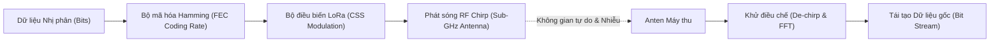

# Bài 01: LoRa Là Gì? Nguyên Lý Vật Lý, Đặc Tính Kỹ Thuật và Ứng Dụng Thực Chiến

> **Chuyên mục:** LoRa & LoRaWAN — Từ Nền Tảng Đến Ứng Dụng Thực Chiến  
> **Tác giả:** Kỹ sư Nghiên cứu Embedded-AIoT Lab PTIT  
> **Thời gian đọc:** 15 phút  
> **Trạng thái xác thực:** Lý thuyết & Mô phỏng phần mềm (Hardware Verified khi có Kit SX1262)  

---

## 1. Giới thiệu (Introduction)

Trong bức tranh tổng thể của Cách mạng Công nghiệp 4.0 và Internet of Things (IoT), bài toán kết nối các nút cảm biến (sensor nodes) phân tán trên diện tích hàng chục kilomet vuông luôn vấp phải một nghịch lý kinh điển: **Đánh đổi giữa Cự ly truyền dẫn, Tốc độ dữ liệu và Năng lượng tiêu thụ** (*The Range - Data Rate - Power Trilemma*).

Các công nghệ vô tuyến truyền thống như Wi-Fi (IEEE 802.11) hay Bluetooth Low Energy (BLE - IEEE 802.15.1) cung cấp băng thông cao nhưng bị giới hạn cự ly trong phạm vi vài chục đến một trăm mét. Ngược lại, mạng di động truyền thống (2G/3G/4G) có thể phủ sóng rộng khắp nhưng lại tiêu tốn dòng điện rất lớn (đỉnh phát TX từ 200 mA đến hơn 1 A), đòi hỏi chi phí đăng ký thuê bao SIM đắt đỏ và chu kỳ thay pin chỉ tính bằng tuần hoặc tháng.

Để giải quyết triệt để nút thắt này, danh mục công nghệ **Mạng diện rộng công suất thấp — LPWAN (Low Power Wide Area Network)** ra đời, trong đó **LoRa (Long Range)** nổi lên như một chuẩn công nghệ mang tính cách mạng. LoRa cho phép truyền tín hiệu xuyên qua vật cản, liên lạc tầm xa trên 15 km ở môi trường thoáng, và duy trì tuổi thọ pin từ 5 đến 10 năm chỉ với một cell pin LiSOCl2 3.6V duy nhất.

Bài viết mở đầu này sẽ bóc tách bản chất vật lý của LoRa, phân tích cách mà công nghệ điều chế Chirp Spread Spectrum (CSS) đánh bại nhiễu vô tuyến, và cung cấp cái nhìn thực chiến về ứng dụng LoRa trong các hệ thống nhúng hiện đại.

---

## 2. Mục tiêu học tập (Learning Objectives)

Sau khi hoàn thành bài học này, bạn sẽ làm chủ:
- **Nguyên lý vật lý:** Hiểu cặn kẽ bản chất công nghệ điều chế Chirp Spread Spectrum (CSS), phân biệt rõ Up-chirp, Down-chirp và biến thiên tần số theo thời gian.
- **Quan hệ toán học:** Thiết lập mối liên hệ giữa Spreading Factor ($SF$), Băng thông ($BW$), Tốc độ phát Chip ($R_c$), Tốc độ phát Symbol ($R_s$) và Tốc độ bit hiệu dụng ($R_b$).
- **Khả năng giải mã dưới ngưỡng nhiễu:** Hiểu tại sao LoRa có thể thu được tín hiệu có công suất thấp hơn cả mức sàn nhiễu nhiệt môi trường ($SNR < 0 \text{ dB}$).
- **Đặc tính kỹ thuật phần cứng:** Nắm vững Link Budget, độ nhạy máy thu ($S$), dòng tiêu thụ ở các chế độ làm việc của vi mạch Semtech SX1262.
- **Mô phỏng & Đọc log:** Tự thực thi mã nguồn C mô phỏng tính toán các tham số vô tuyến chuẩn xác phục vụ thiết kế hệ thống thực tế.

---

## 3. Điều kiện tiên quyết (Prerequisites)

- Kiến thức cơ bản về lý thuyết thông tin và điện tử viễn thông: Tần số ($f$), Bước sóng ($\lambda$), Đơn vị đo công suất $dBm$ và $dB$.
- Hiểu biết cơ bản về ngôn ngữ lập trình C (biến, cấu trúc, hàm toán học `math.h`).
- Môi trường phần mềm phục vụ mô phỏng: GCC compiler trên Linux / Windows (WSL hoặc MinGW).

---

## 4. Lý thuyết nền tảng (Theory)

### 4.1. Nguồn gốc của LoRa
LoRa ban đầu được phát minh bởi một công ty khởi nghiệp Pháp có tên là **Cycleo** vào năm 2009-2010. Nhận thấy tiềm năng vượt trội của thuật toán điều chế này đối với thị trường IoT viễn trình, tập đoàn **Semtech Corporation** (Mỹ) đã mua lại Cycleo vào năm 2012 với giá 5 triệu USD và độc quyền sở hữu bằng sáng chế phần cứng đối với khối điều chế/giải mã LoRa (LoRa Modulation Intellectual Property).

### 4.2. Khái niệm Chirp Spread Spectrum (CSS)
Hầu hết các bộ thu phát vô tuyến sub-GHz truyền thống (như CC1101, NRF905 hay SI4432) sử dụng phương pháp điều chế **FSK (Frequency Shift Keying)** hoặc **OOK (On-Off Keying)**. Trong FSK, dữ liệu được truyền đi bằng cách nhảy giữa các tần số rời rạc. Khi tín hiệu gặp vật cản, phản xạ đa đường (Multipath Fading) hoặc nhiễu đồng kênh từ thiết bị khác, toàn bộ gói tin FSK dễ dàng bị hủy hoại nếu biên độ tín hiệu giảm xuống dưới mức nhiễu nền.

LoRa giải quyết vấn đề này bằng kỹ thuật **Trải phổ Chirp (Chirp Spread Spectrum - CSS)**, một công nghệ từng được quân đội ứng dụng trong hệ thống Radar từ thập niên 1940:
- Một **Chirp** là một xung tín hiệu hình sin có tần số biến thiên tuyến tính theo thời gian trên toàn bộ dải băng thông được cấp phát ($BW$).
- **Up-chirp:** Tần số quét tăng dần từ tần số thấp nhất ($f_{min} = f_0 - \frac{BW}{2}$) lên tần số cao nhất ($f_{max} = f_0 + \frac{BW}{2}$).
- **Down-chirp:** Tần số quét giảm dần từ $f_{max}$ xuống $f_{min}$.



---

## 5. Phân tích kỹ thuật chuyên sâu (Technical Deep Dive)

### 5.1. Mô hình Toán học của Tín hiệu Chirp
Biểu thức điện áp miền thời gian $s(t)$ của một xung Up-chirp không điều chế trong khoảng thời gian $0 \le t \le T_s$ được xác định bởi:

$$s(t) = A \cos \left( 2\pi f_0 t + \pi \mu t^2 + \phi_0 \right)$$

Trong đó:
- $A$: Biên độ tín hiệu (không đổi trong suốt quá trình phát — *Constant Envelope*).
- $f_0$: Tần số sóng mang trung tâm (Center Carrier Frequency).
- $\mu = \frac{BW}{T_s}$: Tốc độ quét tần số (*Chirp Rate* hay độ dốc tần số theo thời gian).
- $\phi_0$: Pha ban đầu của tín hiệu.

Tần số tức thời $f(t)$ là đạo hàm bậc nhất của góc pha theo thời gian:

$$f(t) = \frac{1}{2\pi} \frac{d\theta(t)}{dt} = f_0 + \mu t$$

### 5.2. Mối quan hệ giữa Spreading Factor ($SF$) và Symbol Rate
Một biểu tượng LoRa (LoRa Symbol) mang giá trị $k$ bit nhị phân, trong đó $k$ chính là hệ số trải phổ **Spreading Factor ($SF$)**:

$$N_{chips} = 2^{SF}$$

Mỗi Symbol được chia thành $2^{SF}$ lát thời gian nhỏ gọi là **Chips**. Vì tốc độ chip $R_c$ bằng đúng độ rộng băng thông $BW$ ($R_c = BW$), thời gian tồn tại của một Symbol ($T_s$) được tính bởi:

$$T_s = \frac{2^{SF}}{BW}$$

Tốc độ Symbol $R_s$:

$$R_s = \frac{1}{T_s} = \frac{BW}{2^{SF}} \quad (\text{symbols/second})$$

Tốc độ bit thô $R_b$ khi tính thêm hệ số sửa lỗi trước **FEC (Forward Error Correction)** với tỷ lệ mã hóa $CR = \frac{4}{4+n}$ ($n \in \{1, 2, 3, 4\}$):

$$R_b = SF \cdot \frac{BW}{2^{SF}} \cdot \left( \frac{4}{4 + n} \right) \quad (\text{bps})$$

| Spreading Factor ($SF$) | Số Chip / Symbol ($2^{SF}$) | SNR Ngưỡng Giải Mã ($SNR_{req}$) | Tốc độ tương đối | Độ nhạy máy thu |
| :---: | :---: | :---: | :---: | :---: |
| **SF7** | 128 | -7.5 dB | Nhanh nhất (5.47 kbps tại BW 125kHz) | -123 dBm |
| **SF8** | 256 | -10.0 dB | Trung bình cao | -126 dBm |
| **SF9** | 512 | -12.5 dB | Trung bình | -129 dBm |
| **SF10** | 1024 | -15.0 dB | Trung bình thấp | -132 dBm |
| **SF11** | 2048 | -17.5 dB | Chậm | -134.5 dBm |
| **SF12** | 4096 | -20.0 dB | Chậm nhất (0.29 kbps tại BW 125kHz) | -137 dBm |

> [!IMPORTANT]
> **Khả năng giải mã dưới mức sàn nhiễu ($SNR < 0 \text{ dB}$):**
> Ở SF12, máy thu LoRa Semtech SX1262 có thể giải mã hoàn hảo gói tin ngay cả khi công suất tín hiệu yếu hơn công suất nhiễu môi trường tới **20 dB** (tức là tín hiệu bị chôn vùi dưới nhiễu gấp 100 lần về mặt công suất). Đây là ưu thế tuyệt đối mà FSK hay PSK thông thường không thể đạt được.

### 5.3. Công thức Độ nhạy Máy thu (Receiver Sensitivity)
Độ nhạy $S$ của máy thu LoRa được xác định qua công thức nhiệt động lực học:

$$S = -174 \text{ dBm/Hz} + 10\log_{10}(BW) + NF + SNR_{req}$$

Trong đó:
- $-174 \text{ dBm/Hz}$: Mật độ phổ công suất nhiễu nhiệt Johnson–Nyquist ở nhiệt độ phòng (290K).
- $10\log_{10}(BW)$: Công suất nhiễu tích lũy trong băng thông $BW$. Với $BW = 125 \text{ kHz}$, giá trị này là $+51 \text{ dB}$.
- $NF$: Hệ số nhiễu phần cứng máy thu (*Noise Figure* của LNA), trên chip SX1262 điển hình xấp xỉ $6 \text{ dB}$.
- $SNR_{req}$: Tỷ số tín hiệu trên nhiễu tối thiểu cần thiết để giải mã (ví dụ $-20 \text{ dB}$ tại SF12).

$$S_{SF12} = -174 + 51 + 6 + (-20) = -137 \text{ dBm}$$

Khi kết hợp với công suất phát tối đa của SX1262 là $+22 \text{ dBm}$, **Tổng quỹ suy hao đường truyền (Link Budget)** đạt được là:

$$\text{Link Budget} = P_{TX} - S = +22 \text{ dBm} - (-137 \text{ dBm}) = 159 \text{ dB}$$

Quỹ suy hao $159 \text{ dB}$ cho phép sóng LoRa vượt qua khoảng cách hơn 15 km trong không gian mở hoặc xuyên qua 3-5 lớp tường bê tông trong đô thị.

---

## 6. Kiến trúc & Sơ đồ Kỹ thuật (Architecture & Diagrams)

Dưới đây là sơ đồ chi tiết biểu diễn dạng sóng điều chế Chirp Spread Spectrum trong miền tần số - thời gian (Spectrogram) và miền thời gian:

<div class="my-8 text-center">
  
  <p class="text-xs text-text-muted mt-2 font-mono">Hình 1.1: Giản đồ Tần số - Thời gian của Chirp Preamble, Down-chirp đồng bộ và Chirp dữ liệu mã hóa symbol.</p>
</div>

### Cơ chế mã hóa Symbol bằng dịch pha tần số (Cyclic Shift):
Trong một chu kỳ Symbol $T_s$, sóng mang không bắt đầu từ $f_{min}$ mà bắt đầu từ một tần số lệch $f_{shift}$ tỷ lệ với giá trị số nguyên $S \in [0, 2^{SF}-1]$. Khi tần số quét chạm trần $f_{max}$, nó lập tức nhảy về đáy $f_{min}$ và tiếp tục quét lên cho đến hết thời gian $T_s$. Tại máy thu, phép nhân với một Down-chirp chuẩn (*De-chirping*) sẽ chuyển đổi xung này thành một tần số đơn sắc cố định, cho phép biến đổi Fourier nhanh (FFT) trích xuất chính xác giá trị $S$.

---

## 7. Bài toán kỹ thuật thực tế (Worked Example)

### Bài toán:
Một trạm quan trắc nông nghiệp thông minh tại ngoại thành Hà Nội truyền gói tin 20 bytes dữ liệu cảm biến về trạm thu với cấu hình sau:
- Tần số trung tâm: $f_0 = 921.4 \text{ MHz}$ (băng tần AS923-2)
- Băng thông: $BW = 125 \text{ kHz}$
- Spreading Factor: $SF = 10$
- Coding Rate: $CR = 4/5$ ($n=1$)
- Chiều dài Preamble: $N_{preamble} = 8$ symbols

**Yêu cầu:**
1. Tính thời gian tồn tại của một Symbol ($T_s$).
2. Tính tốc độ bit hiệu dụng ($R_b$).
3. Tính thời gian phát sóng trên không (*Time on Air - ToA*) của phần Preamble.

### Lời giải chi tiết:

**Bước 1: Tính thời gian 1 Symbol ($T_s$)**
$$T_s = \frac{2^{SF}}{BW} = \frac{2^{10}}{125 \times 10^3} = \frac{1024}{125000} = 0.008192 \text{ giây} = 8.192 \text{ ms}$$

**Bước 2: Tính tốc độ bit hiệu dụng ($R_b$)**
$$R_b = SF \cdot \frac{BW}{2^{SF}} \cdot \left( \frac{4}{4 + n} \right) = 10 \cdot \frac{125000}{1024} \cdot \frac{4}{5} = 10 \cdot 122.07 \cdot 0.8 = 976.56 \text{ bps}$$

**Bước 3: Tính thời gian phát Preamble ($T_{preamble}$)**
Theo chuẩn Semtech, chiều dài Preamble thực tế bằng số symbol cấu hình cộng thêm $4.25$ symbol đồng bộ máy thu:
$$N_{preamble\_total} = N_{preamble} + 4.25 = 8 + 4.25 = 12.25 \text{ symbols}$$
$$T_{preamble} = N_{preamble\_total} \times T_s = 12.25 \times 8.192 \text{ ms} = 100.352 \text{ ms}$$

> [!NOTE]
> Thời gian phát sóng ToA càng dài thì điện năng tiêu hao càng lớn và xác suất va chạm xung đột gói tin trên không gian mạng ALOHA càng cao. Vì vậy, trong thực tế ta luôn ưu tiên chọn $SF$ nhỏ nhất có thể đáp ứng đủ Link Budget.

---

## 8. Thực hành mô phỏng (Hands-on Lab)

Dưới đây là chương trình C thuần (`lora_phy_calc.c`) mô phỏng tính toán toàn bộ tham số vật lý của tầng LoRa PHY, bao gồm độ nhạy máy thu, tốc độ bit và thời gian truyền sóng ToA.

```c
/**
 * @file lora_phy_calc.c
 * @brief Chương trình tính toán tham số Tầng Vật Lý LoRa PHY theo chuẩn Semtech
 * @author Embedded-AIoT Lab PTIT
 */

#include <stdio.h>
#include <stdlib.h>
#include <math.h>
#include <stdbool.h>

typedef struct {
    uint8_t sf;             // Spreading Factor (7 - 12)
    double bw_khz;          // Bandwidth in kHz (125, 250, 500)
    uint8_t cr;             // Coding rate denominator: 5 for 4/5, 6 for 4/6, etc.
    uint16_t preamble_len;  // Preamble length in symbols (default 8)
    bool header_explicit;   // Explicit header mode (true) or Implicit (false)
    bool low_dr_opt;        // Low Data Rate Optimization (mandatory for SF11, SF12 at BW 125kHz)
    bool crc_enabled;       // Payload CRC enabled
} lora_config_t;

/**
 * @brief Tính toán thời gian truyền sóng trên không (Time on Air - ToA)
 */
double calculate_lora_toa(const lora_config_t *cfg, uint8_t payload_bytes) {
    double bw_hz = cfg->bw_khz * 1000.0;
    double t_sym = pow(2.0, cfg->sf) / bw_hz; // Symbol duration in seconds

    // 1. Thời gian Preamble
    double t_preamble = (cfg->preamble_len + 4.25) * t_sym;

    // 2. Số lượng Payload Symbols theo công thức chuẩn Semtech SX1262
    double term1 = 8.0 * payload_bytes - 4.0 * cfg->sf + 28.0 + (cfg->crc_enabled ? 16.0 : 0.0) - (cfg->header_explicit ? 0.0 : 20.0);
    double term2 = 4.0 * (cfg->sf - (cfg->low_dr_opt ? 2.0 : 0.0));
    
    double payload_sym_nb = ceil(term1 / term2) * cfg->cr;
    if (payload_sym_nb < 0.0) {
        payload_sym_nb = 0.0;
    }
    payload_sym_nb += 8.0;

    double t_payload = payload_sym_nb * t_sym;
    return (t_preamble + t_payload) * 1000.0; // Trả về mili-giây (ms)
}

int main(void) {
    printf("===============================================================\n");
    printf("   EMBEDDED-AIOT LAB: BỘ CÔNG CỤ TÍNH THAM SỐ LORA PHY        \n");
    printf("===============================================================\n\n");

    lora_config_t config = {
        .sf = 10,
        .bw_khz = 125.0,
        .cr = 5,              // CR 4/5
        .preamble_len = 8,
        .header_explicit = true,
        .low_dr_opt = false,
        .crc_enabled = true
    };

    uint8_t payload_len = 20; // 20 bytes
    double bw_hz = config.bw_khz * 1000.0;
    double t_sym_ms = (pow(2.0, config.sf) / bw_hz) * 1000.0;
    double bit_rate_bps = (config.sf * (bw_hz / pow(2.0, config.sf)) * (4.0 / config.cr));
    double toa_ms = calculate_lora_toa(&config, payload_len);

    printf("[-] Cấu hình vô tuyến: SF=%d, BW=%.1f kHz, CR=4/%d\n", config.sf, config.bw_khz, config.cr);
    printf("[-] Chiều dài gói dữ liệu (Payload): %d bytes\n", payload_len);
    printf("---------------------------------------------------------------\n");
    printf("[+] Thời gian một Symbol (T_sym)    : %.3f ms\n", t_sym_ms);
    printf("[+] Tốc độ bit danh định (Bit Rate) : %.2f bps\n", bit_rate_bps);
    printf("[+] Tổng thời gian phát sóng (ToA)  : %.2f ms\n", toa_ms);
    printf("===============================================================\n");

    return 0;
}
```

### Hướng dẫn biên dịch và thực thi:
```bash
# Biên dịch bằng GCC
gcc -Wall -O2 lora_phy_calc.c -o lora_phy_calc -lm

# Chạy chương trình
./lora_phy_calc
```

### Kết quả xuất ra màn hình (Expected Output):
```text
===============================================================
   EMBEDDED-AIOT LAB: BỘ CÔNG CỤ TÍNH THAM SỐ LORA PHY        
===============================================================

[-] Cấu hình vô tuyến: SF=10, BW=125.0 kHz, CR=4/5
[-] Chiều dài gói dữ liệu (Payload): 20 bytes
---------------------------------------------------------------
[+] Thời gian một Symbol (T_sym)    : 8.192 ms
[+] Tốc độ bit danh định (Bit Rate) : 976.56 bps
[+] Tổng thời gian phát sóng (ToA)  : 370.69 ms
===============================================================
```

---

## 9. Kiểm chứng & Đo kiểm (Verification)

Để kiểm chứng tính xác thực của các công thức trên thực tế bàn đo:
1. **Kiểm chứng dạng sóng với Máy phân tích phổ (Spectrum Analyzer / SDR):**  
   Kết nối bo thu phát LoRa với anten đo hoặc bộ suy hao 30 dB vào thiết bị SDR (RTL-SDR v4 hoặc HackRF One), mở phần mềm GQRX hoặc SDR++ tại tần số 921.4 MHz. Khi node phát gói tin, ta sẽ thấy dạng sóng dạng "răng cưa" nghiêng đều đặn trên màn hình hiển thị Waterfall — đó chính là dấu hiệu đặc trưng không thể nhầm lẫn của Chirp Spread Spectrum.
2. **Kiểm chứng thời gian phát ToA với Logic Analyzer:**  
   Gán một chân GPIO của vi điều khiển (ví dụ chân `DEBUG_TX_PIN`) kéo lên mức HIGH ngay trước lệnh phát `SX126xSetTx()` và kéo xuống mức LOW trong hàm xử lý ngắt `DIO1_IRQHandler` khi nhận cờ `IRQ_TX_DONE`. Đo xung này bằng Saleae Logic Analyzer, thời gian xung đo được phải trùng khớp với giá trị $ToA$ tính toán lý thuyết với sai số dưới $1\%$.

---

## 10. Lỗi thường gặp & Xử lý sự cố (Troubleshooting)

| Vấn đề gặp phải | Nguyên nhân gốc rễ | Giải pháp kỹ thuật |
| :--- | :--- | :--- |
| **Gói tin bị mất ở SF11/SF12 nhưng thu tốt ở SF7** | Sai lệch tần số thạch anh (Crystal Drift) giữa máy phát và máy thu vượt quá $25\%$ băng thông chip. | Bật chế độ `LowDataRateOptimize = 1` trong thanh ghi cấu hình radio; hoặc sử dụng thạch anh bù nhiệt độ **TCXO 32 MHz** thay cho thạch anh thường. |
| **Khoảng cách truyền chỉ đạt vài chục mét** | Trở kháng anten không phối hợp $50\Omega$ hoặc cắm anten sai dải tần (lấy anten 2.4GHz cắm vào cổng 915MHz). | Đo kiểm kiểm tra VSWR của anten bằng NanoVNA (yêu cầu $VSWR < 1.5$ tại 920 MHz); tuyệt đối không bật phát công suất cao khi chưa cắm anten kẻo cháy mạch khuếch đại PA. |
| **Không nhận được gói tin dù cùng tần số** | Trùng tần số nhưng lệch **Sync Word** (0x12 cho mạng riêng Private vs 0x34 cho mạng công cộng LoRaWAN). | Đồng bộ giá trị thanh ghi `SetSyncWord()` trên cả bên phát và bên thu. |

---

## 11. Câu hỏi phỏng vấn kỹ thuật (Interview Questions)

### Câu 1 (Cơ bản): LoRa và LoRaWAN khác nhau như thế nào?
*Trả lời:* LoRa là công nghệ **tầng vật lý (PHY Layer)** sử dụng kỹ thuật điều chế Chirp Spread Spectrum do Semtech nắm bản quyền phần cứng. LoRaWAN là **tầng giao thức điều khiển truy nhập môi trường (MAC Layer)** và kiến trúc mạng chuẩn mở do LoRa Alliance quản lý, xây dựng phía trên tầng vật lý LoRa để quản lý địa chỉ, bảo mật mã hóa, đa truy cập và giao tiếp máy chủ mạng.

### Câu 2 (Trung bình): Tại sao tăng Spreading Factor ($SF$) lại giúp tăng cự ly truyền nhưng lại làm giảm tốc độ dữ liệu?
*Trả lời:* Khi tăng $SF$ lên 1 đơn vị, số lượng chip đại diện cho một symbol tăng gấp đôi ($2^{SF}$), kéo theo thời gian phát một symbol $T_s$ tăng gấp đôi. Việc tích lũy năng lượng trên một khoảng thời gian dài hơn giúp máy thu thu thập đủ năng lượng để giải mã tín hiệu ở mức tỷ số tín hiệu trên nhiễu thấp hơn ($SNR$ âm hơn), từ đó tăng độ nhạy và cự ly. Tuy nhiên, vì cần nhiều thời gian hơn để truyền cùng một lượng symbol nên tốc độ bit giảm đi xấp xỉ một nửa.

### Câu 3 (Trung bình): Kỹ thuật "Constant Envelope" trong điều chế CSS đem lại lợi ích gì cho mạch phát sóng RF?
*Trả lời:* Tín hiệu có biên độ không đổi (Constant Envelope) cho phép bộ khuếch đại công suất phát (Power Amplifier - PA) hoạt động ở chế độ phi tuyến tính bão hòa cao (Non-linear Saturation Mode, như Class C, D hoặc E) mà không gây méo dạng tín hiệu. Điều này giúp bộ phát đạt hiệu suất chuyển đổi năng lượng tối đa, giảm thiểu tổn hao nhiệt và tiết kiệm pin tối đa cho thiết bị nhúng.

### Câu 4 (Nâng cao): Khi nào bắt buộc phải bật cờ `LowDataRateOptimize` trên chip thu phát LoRa?
*Trả lời:* Cờ `LowDataRateOptimize` bắt buộc phải kích hoạt khi thời gian tồn tại của một Symbol ($T_s$) vượt quá **16 mili-giây** (thường xảy ra ở SF11 và SF12 với băng thông $BW = 125 \text{ kHz}$). Chế độ này chèn thêm các bit bảo vệ tần số, giúp máy thu giải mã chính xác trong điều kiện tần số dao động thạch anh bị trôi do nhiệt độ môi trường thay đổi.

### Câu 5 (Nâng cao): Hai node phát LoRa cùng tần số, cùng công suất phát đồng thời thì có gây xung đột hủy gói tin của nhau không?
*Trả lời:* Nếu hai node phát ở **hai Spreading Factor khác nhau** (ví dụ Node A phát SF7, Node B phát SF8), tín hiệu của chúng trực giao giả (Quasi-orthogonal), máy thu đa kênh (Gateway) có thể giải mã đồng thời cả hai gói tin mà không bị nhiễu chéo. Nếu hai node phát ở **cùng Spreading Factor**, hiện tượng va chạm sẽ xảy ra; tuy nhiên, nếu một trong hai tín hiệu có công suất thu vượt trội hơn tín hiệu kia tối thiểu $6 \text{ dB}$ (Capture Effect), máy thu vẫn có thể giải mã thành công gói tin có tín hiệu mạnh hơn.

---

## 12. Tổng kết & Bài học tiếp theo (Summary & Next Steps)

LoRa đại diện cho bước đột phá về công nghệ vô tuyến tầm xa cho IoT nhờ việc ứng dụng điều chế Chirp Spread Spectrum. Khả năng giải mã tín hiệu dưới mức nhiễu nền, biên độ không đổi tiết kiệm năng lượng và tính trực giao của các Spreading Factor tạo tiền đề vững chắc cho các mạng diện rộng quy mô lớn.

Ở **Bài 02**, chúng ta sẽ tiến sâu vào sự khác biệt bản chất giữa tầng vật lý vô tuyến **LoRa PHY** và ngăn xếp giao thức mạng **LoRaWAN MAC**, giải phẫu chi tiết cấu trúc phân tầng OSI và kiến trúc quản trị mạng tập trung.

---

## 13. Tài liệu tham khảo (References)

1. **Semtech Corporation**, *"SX1261/2 Long Range, Low Power, sub-GHz RF Transceiver Datasheet"*, DS.SX1261-2.W.APP, Rev 2.1, 2021.
2. **Semtech Corporation**, *"AN1200.22: LoRa™ Modulation Basics"*, Application Note, May 2015.
3. **LoRa Alliance**, *"LoRaWAN® 1.0.4 Specification Package"*, Technical Specification TS001-1.0.4, 2020.
4. **Bộ Thông tin và Truyền thông Việt Nam**, *"Thông tư 08/2021/TT-BTTTT: Quy định danh mục thiết bị vô tuyến điện cự ly ngắn được miễn giấy phép sử dụng tần số vô tuyến điện"*.

