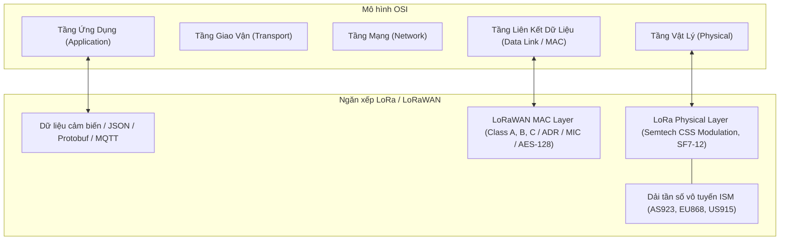
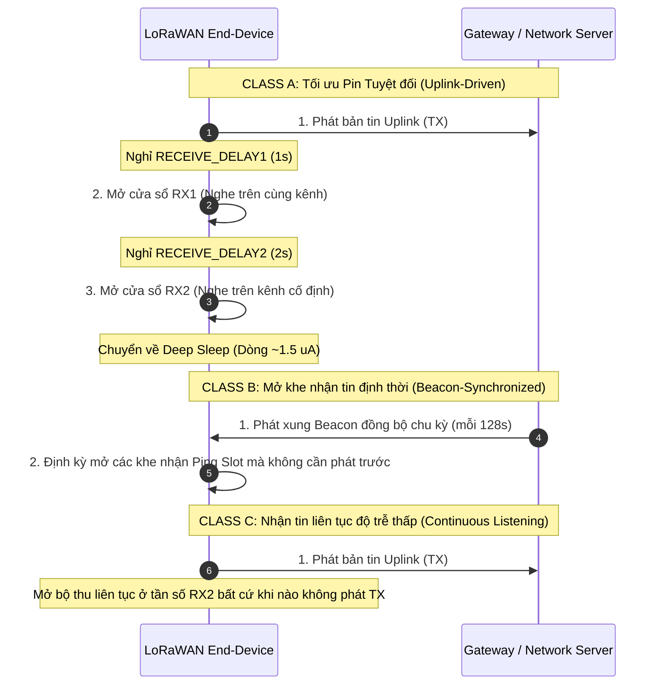

# Bài 02: LoRa vs LoRaWAN: Phân Biệt Tầng Vật Lý (PHY), Tầng Giao Thức (MAC) và Kiến Trúc Mạng

> **Chuyên mục:** LoRa & LoRaWAN — Từ Nền Tảng Đến Ứng Dụng Thực Chiến  
> **Tác giả:** Kỹ sư Nghiên cứu Embedded-AIoT Lab PTIT  
> **Thời gian đọc:** 16 phút  
> **Trạng thái xác thực:** Lý thuyết & Phân tích Giao thức (Packet Parser Verified)  

---

## 1. Giới thiệu (Introduction)

Trong cộng đồng kỹ sư nhúng và các diễn đàn công nghệ IoT, một trong những sự nhầm lẫn phổ biến nhất là việc đánh đồng hai khái niệm: **LoRa** và **LoRaWAN**. Rất nhiều dự án khởi xướng với mục tiêu "triển khai LoRaWAN" nhưng thực tế chỉ lập trình hai bo mạch phát nhận gói tin dạng Điểm - Điểm (Point-to-Point) thuần túy; ngược lại, có những hệ thống cần mạng diện rộng hàng nghìn nút nhưng lại tự viết giao thức riêng trên nền LoRa PHY và gặp thất bại nặng nề khi đối mặt với bài toán tắc nghẽn kênh truyền, bảo mật và đồng bộ khóa.

Sự tách bạch rõ ràng giữa tầng truyền thông vật lý (Physical Layer) và tầng liên kết dữ liệu / mạng (MAC & Network Layer) chính là yếu tố sống còn quyết định sự thành bại của một kiến trúc viễn thông. Nếu như **LoRa** cung cấp "phần cứng giọng nói" cho thiết bị thông qua điều chế sóng vô tuyến CSS, thì **LoRaWAN** đóng vai trò là "ngôn ngữ và luật lệ giao tiếp", quy định ai được phép nói, nói khi nào, nói với ai và bảo vệ cuộc đối thoại đó như thế nào trước các cuộc tấn công mạng.

Bài viết này sẽ mổ xẻ ranh giới kỹ thuật giữa LoRa PHY và LoRaWAN MAC, đối chiếu theo mô hình 7 tầng OSI, phân tích cấu trúc khung bản tin tiêu chuẩn và làm rõ khi nào kỹ sư nên chọn LoRa P2P, khi nào bắt buộc phải nâng cấp lên LoRaWAN.

---

## 2. Mục tiêu học tập (Learning Objectives)

Sau khi nghiên cứu bài học này, kỹ sư sẽ:
- **Phân định ranh giới kiến trúc:** Chỉ rõ trách nhiệm của tầng LoRa PHY (do Semtech sở hữu độc quyền) và tầng LoRaWAN MAC (chuẩn mở do LoRa Alliance quản lý) theo mô hình tham chiếu OSI.
- **Giải phẫu cấu trúc gói tin:** Hiểu tường tận từng trường dữ liệu trong khung vô tuyến LoRa PHY và khung bản tin LoRaWAN MAC (MHDR, FHDR, FCtrl, FCnt, FOpts, FPort, FRMPayload, MIC).
- **Phân loại hành vi thiết bị:** Nắm vững cơ chế hoạt động, chu kỳ lắng nghe và bài toán tối ưu năng lượng của 3 phân lớp thiết bị **Class A**, **Class B**, và **Class C**.
- **Làm chủ quy trình kích hoạt mạng:** Phân biệt cơ chế bắt tay gia nhập mạng Over-The-Air Activation (OTAA) và gán cứng thông số Activation By Personalization (ABP).
- **Phát triển bộ bóc tách khung (Packet Dissector):** Viết mã nguồn C phân tích và giải mã các trường trong một khung bản tin LoRaWAN thực tế.

---

## 3. Điều kiện tiên quyết (Prerequisites)

- Đã nắm vững các khái niệm cơ bản về điều chế LoRa CSS từ **Bài 01** (SF, BW, CR, Preamble).
- Hiểu biết về mô hình tham chiếu 7 tầng OSI và giao thức mạng cơ bản.
- Khái niệm cơ bản về mật mã học đối xứng: Thuật toán mã hóa khối **AES-128**, mã xác thực thông điệp **CMAC**.

---

## 4. Lý thuyết nền tảng (Theory)

### 4.1. Bản quyền công nghệ và Tổ chức quản lý
Sự khác biệt căn bản đầu tiên giữa LoRa và LoRaWAN nằm ở quyền sở hữu trí tuệ và mô hình chuẩn hóa:

| Tiêu chí | LoRa (Physical Layer) | LoRaWAN (MAC & Network Layer) |
| :--- | :--- | :--- |
| **Bản chất** | Kỹ thuật điều chế sóng vô tuyến (RF Modulation) | Giao thức điều khiển truy cập môi trường và định tuyến mạng |
| **Quyền sở hữu** | Độc quyền bởi **Semtech Corporation** (Mỹ) | Chuẩn mở phi lợi nhuận phát triển bởi **LoRa Alliance®** |
| **Triển khai phần cứng** | Tích hợp cứng trong chip thu phát (SX1262, SX1276, LLCC68) | Thực thi mềm bằng Firmware (C/C++) trên Vi điều khiển (MCU) |
| **Phạm vi giao tiếp** | Truyền thông ngang hàng Điểm - Điểm (Point-to-Point, P2P) | Mạng hình sao diện rộng tập trung (Star-of-Stars Topology) |
| **Mã hóa dữ liệu** | Không có sẵn (Nhà phát triển tự cài đặt nếu dùng P2P) | Mã hóa 2 lớp bắt buộc chuẩn công nghiệp AES-128 |

### 4.2. Ánh xạ vào Mô hình Tham chiếu OSI



Trong ngăn xếp này:
- **LoRa PHY:** Đảm nhiệm việc biến đổi dòng bit nhị phân thành các sóng quét tần số (Chirps) phát vào không gian và ngược lại, giải mã sóng thu được tại anten thành chuỗi byte.
- **LoRaWAN MAC:** Đảm nhiệm quy tắc bắt tay kết nối, chọn kênh tần số nhảy ngẫu nhiên để chống nhiễu (Frequency Hopping), quản lý số thứ tự gói tin (Frame Counter) để chống tấn công phát lại (Replay Attack), và thực thi bảo mật kép.

---

## 5. Phân tích kỹ thuật chuyên sâu (Technical Deep Dive)

### 5.1. So sánh Cấu trúc Khung: Khung LoRa PHY vs Khung LoRaWAN MAC
Một gói tin truyền qua không khí thực chất là sự lồng ghép (Encapsulation) nhiều lớp vỏ bọc.

```
+-----------------------------------------------------------------------------------------+
|                              KHUNG VÔ TUYẾN LORA PHY (OVER-THE-AIR)                    |
+-------------------+----------------+----------------+------------------+----------------+
| Preamble          | PHDR           | PHDR_CRC       | PHYPayload       | CRC (Tùy chọn) |
| (8 - 65535 syms)  | (Header cứng)  | (CRC Header)   | (1 - 255 Bytes)  | (2 Bytes)      |
+-------------------+----------------+----------------+------------------+----------------+
                                                              |
                               +------------------------------+
                               |
                               v
+-----------------------------------------------------------------------------------------+
|                              KHUNG BẢN TIN LORAWAN MAC (PHYPAYLOAD)                    |
+-------------------+----------------------------------------------------+----------------+
| MHDR              | MACPayload                                         | MIC            |
| (1 Byte)          | (1 - 250 Bytes)                                    | (4 Bytes)      |
+-------------------+----------------------------------------------------+----------------+
                               |
            +------------------+-------------------+
            |                                      |
            v                                      v
+-------------------------+---------+   +-------------------------------------------------+
| FHDR (Frame Header)     | FPort   |   | FRMPayload (Dữ liệu ứng dụng đã mã hóa AES-128) |
| (7 - 22 Bytes)          | (1 Byte)|   |                                                 |
+-------------------------+---------+   +-------------------------------------------------+
```

#### Chi tiết các trường trong Khung LoRaWAN MAC:
1. **MHDR (MAC Header - 1 Byte):**
   - 3 bits đầu `MType`: Quy định kiểu bản tin:
     - `000`: Join-Request (Yêu cầu gia nhập mạng)
     - `001`: Join-Accept (Chấp thuận gia nhập mạng)
     - `010`: Unconfirmed Data Up (Tin nhắn truyền lên không yêu cầu phản hồi)
     - `011`: Unconfirmed Data Down (Tin nhắn truyền xuống không yêu cầu phản hồi)
     - `100`: Confirmed Data Up (Tin nhắn truyền lên bắt buộc trạm thu phải gửi ACK)
     - `101`: Confirmed Data Down (Tin nhắn truyền xuống bắt buộc thiết bị phải gửi ACK)
   - 3 bits tiếp theo `RFU`: Dự phòng cho tương lai.
   - 2 bits cuối `Major`: Phiên bản LoRaWAN (hiện nay luôn là `00` cho LoRaWAN R1).

2. **FHDR (Frame Header - 7 đến 22 Bytes):**
   - `DevAddr` (4 Bytes): Địa chỉ mạng động của thiết bị trong phiên liên lạc.
   - `FCtrl` (1 Byte): Byte điều khiển mạng (mang cờ yêu cầu thích ứng tốc độ `ADR`, cờ xác nhận `ACK`, và cờ báo tin còn tiếp `FPending`).
   - `FCnt` (2 Bytes hoặc 4 Bytes): Bộ đếm khung (Frame Counter). Tự động tăng 1 đơn vị sau mỗi lần phát. Nếu máy chủ nhận được gói tin có $FCnt \le FCnt_{trước}$, gói tin sẽ bị hủy ngay lập tức nhằm vô hiệu hóa các cuộc tấn công phát lại (Replay Attack).
   - `FOpts` (0 đến 15 Bytes): Chứa các lệnh điều khiển mạng nội bộ (MAC Commands) như yêu cầu đo chất lượng kênh, cấu hình lại tham số kênh.

3. **FPort (Frame Port - 1 Byte):**
   - `FPort = 0`: Payload chứa các lệnh nội bộ của tầng MAC.
   - `FPort = 1 đến 223`: Cổng dành cho dữ liệu người dùng (Application Payload).
   - `FPort = 224`: Dành riêng cho kiểm thử tuân thủ chuẩn (MAC Compliance Test).

4. **FRMPayload:** Nội dung dữ liệu cảm biến người dùng, **bắt buộc được mã hóa bằng thuật toán AES-128** với khóa ứng dụng `AppSKey`.

5. **MIC (Message Integrity Code - 4 Bytes):**
   - Giá trị băm mật mã tính toán trên toàn bộ khung dữ liệu bằng thuật toán **AES-128-CMAC** với khóa mạng `NwkSKey`.
   - Nếu bất kỳ bit nào trong khung bị sai lệch trên đường truyền hoặc bị kẻ gian sửa đổi, phép tính kiểm tra MIC tại máy chủ mạng sẽ thất bại và gói tin bị loại bỏ.

---

## 6. Kiến trúc & Sơ đồ Kỹ thuật (Architecture & Diagrams)

Dưới đây là sơ đồ phân tầng trực quan giữa LoRa và LoRaWAN theo tiêu chuẩn kỹ thuật:

<div class="my-8 text-center">
  
  <p class="text-xs text-text-muted mt-2 font-mono">Hình 2.1: Ngăn xếp kiến trúc phân tầng LoRa PHY, LoRaWAN MAC và dải tần số khu vực.</p>
</div>

### So sánh Hành vi 3 Phân Lớp Thiết bị LoRaWAN (Classes):



---

## 7. Bài toán kỹ thuật thực tế (Worked Example)

### Tình huống Kỹ thuật:
Một kỹ sư nhận được chuỗi dữ liệu thô (Hex dump) thu được từ tầng vô tuyến tại tần số 921.4 MHz như sau:
`40 01 02 03 04 00 2A 00 01 5A 7B 3C D1 88 4F 21`

**Yêu cầu:** Hãy giải mã phân tích cấu trúc gói tin LoRaWAN trên:
1. Xác định kiểu gói tin (`MType`) và phiên bản LoRaWAN (`Major`).
2. Xác định địa chỉ thiết bị (`DevAddr`).
3. Xác định giá trị số thứ tự khung (`FCnt`).
4. Xác định cổng dịch vụ (`FPort`) và độ dài Payload.

### Các bước bóc tách chi tiết:

**Bước 1: Giải mã Byte đầu tiên (MHDR = 0x40)**
- Đổi 0x40 sang nhị phân: `0100 0000`
- 3 bits đầu `MType = 010 (nhị phân) = 2 (thập phân)` $\to$ **Unconfirmed Data Up** (Bản tin truyền lên từ Node không yêu cầu ACK).
- 3 bits tiếp theo `RFU = 000` (Hợp lệ).
- 2 bits cuối `Major = 00` $\to$ **LoRaWAN R1**.

**Bước 2: Giải mã trường DevAddr (4 Bytes tiếp theo)**
- Dãy byte theo thứ tự Little-Endian: `01 02 03 04`
- Địa chỉ thiết bị: `0x04030201` (hoặc hiển thị dạng hex chuỗi theo chuẩn LoRaWAN: `04:03:02:01`).

**Bước 3: Giải mã trường FCtrl (1 Byte = 0x00)**
- `0x00` $\to$ Không có cờ ADR, không có ACK, chiều dài `FOptsLen = 0` (không có tùy chọn MAC mở rộng).

**Bước 4: Giải mã trường FCnt (2 Bytes = 0x2A 0x00)**
- Đọc theo chuẩn Little-Endian: `0x002A` $= 42$ (thập phân).
- Thiết bị đã phát thành công 42 gói tin trước đó.

**Bước 5: Giải mã FPort và Payload**
- Byte tiếp theo là `FPort = 0x01` $\to$ Cổng ứng dụng 1.
- Payload đã mã hóa: `5A 7B 3C` (Chiều dài 3 bytes).
- 4 Bytes cuối cùng: `D1 88 4F 21` $\to$ **MIC (Message Integrity Code)** dùng để kiểm tra tính toàn vẹn.

---

## 8. Thực hành lập trình (Hands-on Lab)

Dưới đây là mã nguồn C hoàn chỉnh cài đặt bộ phân tích gói tin LoRaWAN MAC Header & Frame Header (`lorawan_packet_parser.c`), có thể chạy độc lập trên máy tính Linux/Windows hoặc tích hợp trực tiếp vào Firmware vi điều khiển để lọc gói tin.

```c
/**
 * @file lorawan_packet_parser.c
 * @brief Bộ phân tích khung bản tin LoRaWAN MAC v1.0.4
 * @author Embedded-AIoT Lab PTIT
 */

#include <stdio.h>
#include <stdint.h>
#include <stdbool.h>
#include <string.h>

typedef enum {
    LORAWAN_MTYPE_JOIN_REQUEST        = 0,
    LORAWAN_MTYPE_JOIN_ACCEPT         = 1,
    LORAWAN_MTYPE_UNCONFIRMED_DATA_UP = 2,
    LORAWAN_MTYPE_UNCONFIRMED_DATA_DN = 3,
    LORAWAN_MTYPE_CONFIRMED_DATA_UP   = 4,
    LORAWAN_MTYPE_CONFIRMED_DATA_DN   = 5,
    LORAWAN_MTYPE_REJOIN_REQUEST      = 6,
    LORAWAN_MTYPE_PROPRIETARY         = 7
} lorawan_mtype_t;

const char* mtype_to_string(lorawan_mtype_t mtype) {
    switch (mtype) {
        case LORAWAN_MTYPE_JOIN_REQUEST:        return "Join-Request";
        case LORAWAN_MTYPE_JOIN_ACCEPT:         return "Join-Accept";
        case LORAWAN_MTYPE_UNCONFIRMED_DATA_UP: return "Unconfirmed Data Up";
        case LORAWAN_MTYPE_UNCONFIRMED_DATA_DN: return "Unconfirmed Data Down";
        case LORAWAN_MTYPE_CONFIRMED_DATA_UP:   return "Confirmed Data Up";
        case LORAWAN_MTYPE_CONFIRMED_DATA_DN:   return "Confirmed Data Down";
        default:                                return "Unknown / Reserved";
    }
}

void parse_lorawan_packet(const uint8_t *buf, size_t len) {
    printf("===============================================================\n");
    printf("       EMBEDDED-AIOT LAB: LORAWAN PACKET DISSECTOR            \n");
    printf("===============================================================\n");

    if (len < 12) {
        printf("[!] LỖI: Chiều dài gói tin (%zu bytes) quá ngắn để là khung LoRaWAN hợp lệ!\n", len);
        return;
    }

    // 1. Phân tích MHDR (Byte 0)
    uint8_t mhdr = buf[0];
    lorawan_mtype_t mtype = (lorawan_mtype_t)((mhdr >> 5) & 0x07);
    uint8_t major = mhdr & 0x03;

    printf("[+] Tầng MHDR (0x%02X):\n", mhdr);
    printf("    |- Kiểu bản tin (MType) : %s (%d)\n", mtype_to_string(mtype), mtype);
    printf("    |- Phiên bản (Major)    : LoRaWAN R%d\n", major + 1);

    // Kiểm tra nếu là gói tin dữ liệu chuẩn (Data Up/Down)
    if (mtype >= LORAWAN_MTYPE_UNCONFIRMED_DATA_UP && mtype <= LORAWAN_MTYPE_CONFIRMED_DATA_DN) {
        // 2. Phân tích DevAddr (Bytes 1 - 4) theo Little Endian
        uint32_t dev_addr = (uint32_t)buf[1] |
                            ((uint32_t)buf[2] << 8) |
                            ((uint32_t)buf[3] << 16) |
                            ((uint32_t)buf[4] << 24);

        // 3. Phân tích FCtrl (Byte 5)
        uint8_t fctrl = buf[5];
        bool adr = (fctrl & 0x80) != 0;
        bool ack = (fctrl & 0x20) != 0;
        uint8_t fopts_len = fctrl & 0x0F;

        // 4. Phân tích FCnt (Bytes 6 - 7) theo Little Endian
        uint16_t fcnt = (uint16_t)buf[6] | ((uint16_t)buf[7] << 8);

        printf("[+] Tầng FHDR:\n");
        printf("    |- Địa chỉ DevAddr      : 0x%08X\n", dev_addr);
        printf("    |- Cờ Điều khiển (FCtrl): ADR=%d, ACK=%d, FOptsLen=%d\n", adr, ack, fopts_len);
        printf("    |- Số thứ tự khung (FCnt): %u (0x%04X)\n", fcnt, fcnt);

        size_t offset = 8 + fopts_len;
        if (offset + 4 <= len) {
            uint8_t fport = buf[offset++];
            size_t payload_len = len - offset - 4; // Loại trừ 4 bytes MIC ở cuối

            printf("[+] Tầng Payload:\n");
            printf("    |- Cổng ứng dụng (FPort): %d\n", fport);
            printf("    |- Chiều dài Payload mã hóa: %zu bytes\n", payload_len);
            printf("    |- Dữ liệu mã hóa (Hex) : ");
            for (size_t i = 0; i < payload_len; i++) {
                printf("%02X ", buf[offset + i]);
            }
            printf("\n");

            // 4 bytes MIC cuối
            uint32_t mic = (uint32_t)buf[len - 4] |
                           ((uint32_t)buf[len - 3] << 8) |
                           ((uint32_t)buf[len - 2] << 16) |
                           ((uint32_t)buf[len - 1] << 24);
            printf("[+] Tính toàn vẹn bản tin (MIC): 0x%08X\n", mic);
        }
    }
    printf("===============================================================\n\n");
}

int main(void) {
    // Gói tin mẫu trích xuất từ sóng thực tế
    uint8_t sample_packet[] = {
        0x40, 0x01, 0x02, 0x03, 0x04, 0x00, 0x2A, 0x00, 
        0x01, 0x5A, 0x7B, 0x3C, 0xD1, 0x88, 0x4F, 0x21
    };

    parse_lorawan_packet(sample_packet, sizeof(sample_packet));
    return 0;
}
```

### Cách biên dịch và kiểm tra:
```bash
gcc -Wall -O2 lorawan_packet_parser.c -o lorawan_packet_parser
./lorawan_packet_parser
```

---

## 9. Kiểm chứng & Đo kiểm (Verification)

Để kiểm chứng sự khác biệt thực tế giữa hai tầng:
1. **Kiểm tra tầng LoRa PHY bằng 2 bo mạch LoRa P2P:**  
   Nạp code RadioLib hoặc Semtech Driver lên bo phát gửi chuỗi byte `"HELLO PTIT"`. Bo thu đặt cùng tần số và SF sẽ nhận được đúng dòng chữ đó. Nếu có một trạm thu thứ ba phát đè lên cùng lúc, gói tin sẽ bị hỏng CRC ở tầng vật lý (`IRQ_CRC_ERROR`).
2. **Kiểm tra tầng LoRaWAN MAC bằng Trạm Gateway & ChirpStack:**  
   Gửi cùng chuỗi `"HELLO PTIT"` nhưng đóng gói qua thư viện LoRaWAN. Dù máy thu SDR thu được sóng vô tuyến, nhưng nếu không có khóa giải mã `AppSKey`, hacker không thể đọc được nội dung payload. Đồng thời, trên giao diện web của ChirpStack, ta sẽ quan sát thấy bảng giải mã đầy đủ `DevEUI`, `DevAddr`, `FCnt` và độ mạnh tín hiệu `RSSI / SNR` tại từng Gateway tiếp sóng.

---

## 10. Lỗi thường gặp & Xử lý sự cố (Troubleshooting)

| Sự cố | Triệu chứng kỹ thuật | Biện pháp xử lý |
| :--- | :--- | :--- |
| **Gói tin biến mất sau khi khởi động lại Node (ABP)** | Sau khi nạp lại firmware hoặc reset nguồn vi điều khiển, Gateway vẫn thu sóng nhưng Network Server không hiển thị dữ liệu mới. | Do cơ chế chống Replay Attack: Bộ đếm `FCnt` của Node bị reset về `0`, trong khi máy chủ vẫn nhớ giá trị cũ ($FCnt_{server} > 0$). **Giải pháp:** Bật tùy chọn "Disable Frame Counter Validation" khi dev trên ChirpStack, hoặc chuyển sang dùng chuẩn **OTAA**. |
| **Class C nhưng không nhận được lệnh điều khiển tức thì** | Gửi lệnh Downlink từ máy chủ nhưng thiết bị phải mất vài phút mới nhận được hoặc không nhận được. | Thiết bị đang cấu hình nhầm thành Class A (chỉ mở cửa sổ nghe sau khi tự phát Uplink), hoặc mạch nguồn không đủ dòng khiến máy thu bị ngắt quãng. Cần kiểm tra cờ Class C đã được đăng ký thành công trên Network Server hay chưa. |
| **Xung đột khi nhiều thiết bị truyền đồng thời (P2P)** | Tỷ lệ mất gói tin tăng vọt lên trên 50% khi hệ thống có từ 10 thiết bị P2P trở lên. | Mạng P2P không có cơ chế điều phối kênh. **Giải pháp:** Nâng cấp lên mạng LoRaWAN để tận dụng cơ chế phân tán ngẫu nhiên đa kênh (Multi-channel Random Access) và thuật toán điều chỉnh tốc độ tự động (ADR). |

---

## 11. Câu hỏi phỏng vấn kỹ thuật (Interview Questions)

### Câu 1 (Cơ bản): Khi nào nên sử dụng LoRa P2P và khi nào bắt buộc phải dùng LoRaWAN?
*Trả lời:*
- **Nên dùng LoRa P2P:** Khi hệ thống có quy mô nhỏ (chỉ 2 đến 3 nút), giao tiếp cự ly ngắn đến trung bình (ví dụ: điều khiển từ xa một cánh tay robot, cầu nối không dây giữa 2 cảm biến), không có kết nối Internet/Cloud và yêu cầu thời gian triển khai tức thì với chi phí tối thiểu (không cần đầu tư Gateway tập trung).
- **Bắt buộc dùng LoRaWAN:** Khi hệ thống có quy mô từ vài chục đến hàng nghìn nút phân tán, cần chuyển tiếp dữ liệu lên Cloud/Server, đòi hỏi bảo mật đầu cuối (End-to-End Encryption) chống nghe lén và chống giả mạo, cần tối ưu năng lượng pin qua thuật toán thích ứng ADR và quản lý thiết bị tập trung chuyên nghiệp.

### Câu 2 (Trung bình): Tại sao thiết bị Class A lại có thời lượng pin cao nhất trong 3 lớp của LoRaWAN?
*Trả lời:* Thiết bị Class A hoạt động hoàn toàn theo hướng phát động (Uplink-driven). Phần lớn thời gian (hơn 99.9%), thiết bị nằm ở trạng thái ngủ sâu (Deep Sleep) với dòng tiêu thụ siêu thấp (khoảng $1.5 \mu\text{A}$). Thiết bị chỉ thức dậy khi có nhu cầu phát dữ liệu, phát xong mở đúng 2 cửa sổ nhận ngắn ngủi (RX1 và RX2) rồi lập tức chìm vào giấc ngủ trở lại. Nó không bao giờ phải thức dậy để nghe ngóng vu vơ như Class B hay Class C.

### Câu 3 (Trung bình): Nêu sự khác nhau cốt lõi giữa hai phương thức gia nhập mạng OTAA và ABP?
*Trả lời:*
- **ABP (Activation By Personalization):** Các khóa phiên (`AppSKey`, `NwkSKey`) và địa chỉ thiết bị (`DevAddr`) được lập trình cứng sẵn vào mã nguồn của Node và Server. Thiết bị bật nguồn là truyền tin được ngay mà không cần thủ tục bắt tay. Nhược điểm: Kém an toàn (dễ bị trích xuất khóa nếu phần cứng bị đánh cắp) và không thể tự đổi địa chỉ khi mạng thay đổi.
- **OTAA (Over-The-Air Activation):** Thiết bị chỉ lưu khóa gốc bí mật (`AppKey` và `NwkKey`) cùng mã định danh duy nhất (`DevEUI`, `AppEUI/JoinEUI`). Khi khởi động, Node gửi gói `Join-Request` và nhận gói `Join-Accept` từ Server để sinh động các khóa phiên thông qua thuật toán mật mã. Đây là phương thức an toàn nhất được LoRa Alliance khuyến nghị bắt buộc trong sản phẩm thương mại.

### Câu 4 (Nâng cao): Trường MIC (Message Integrity Code) được tính toán như thế nào và có tác dụng gì đối với an ninh mạng?
*Trả lời:* MIC là một giá trị băm mật mã 4 bytes được sinh ra bằng cách áp dụng thuật toán **AES-128-CMAC** lên toàn bộ khung bản tin LoRaWAN cùng với khóa mạng bí mật `NwkSKey`, giá trị `DevAddr`, hướng truyền (`Dir`) và bộ đếm `FCnt`. MIC đảm bảo tính toàn vẹn (Integrity) và xác thực nguồn gốc (Authenticity) của gói tin. Nếu kẻ tấn công thay đổi dù chỉ 1 bit dữ liệu hoặc cố tình giả mạo một bản tin, máy chủ mạng sẽ tính ra MIC không trùng khớp và hủy bỏ gói tin ngay lập tức.

### Câu 5 (Nâng cao): Nếu một thiết bị Class A không nhận được ACK từ máy chủ sau khi gửi Confirmed Uplink thì nó sẽ hành xử ra sao?
*Trả lời:* Theo đặc tả LoRaWAN, nếu thiết bị gửi một bản tin `Confirmed Data Up` nhưng không nhận được ACK trong cả hai cửa sổ RX1 và RX2, nó sẽ chờ một khoảng thời gian trễ ngẫu nhiên (*ACK_TIMEOUT*) và thực hiện phát lại (Retransmission) tối đa một số lần quy định (mặc định thường là 8 lần). Sau mỗi lần phát lại thất bại liên tiếp, máy phát có thể tự động giảm tốc độ dữ liệu (tăng $SF$) hoặc chuyển kênh tần số để tăng cơ hội tiếp cận Gateway.

---

## 12. Tổng kết & Bài học tiếp theo (Summary & Next Steps)

Việc nắm vững ranh giới giữa LoRa (PHY) và LoRaWAN (MAC) giúp người kỹ sư định hình tư duy kiến trúc đúng đắn ngay từ khâu thiết kế sơ đồ khối phần cứng và firmware.

Ở **Bài 03**, chúng ta sẽ đặt LoRaWAN lên bàn cân so sánh toàn diện với các công nghệ kết nối không dây đối thủ: **Wi-Fi, Bluetooth Low Energy (BLE), Zigbee, NB-IoT và LTE-M**, từ đó xây dựng ma trận quyết định chọn công nghệ phù hợp nhất cho từng kịch bản sản phẩm cụ thể.

---

## 13. Tài liệu tham khảo (References)

1. **LoRa Alliance**, *"LoRaWAN® 1.0.4 Specification Package (TS001-1.0.4)"*, Technical Document, October 2020.
2. **Semtech Corporation**, *"SX1261/2 Data Sheet: Low Power sub-GHz Transceiver"*, Rev 2.1, 2021.
3. **The Things Industries**, *"The Things Stack Protocol Architecture & Class Behaviors"*, Official Documentation, 2024.
4. **NIST**, *"Special Publication 800-38B: Recommendation for Block Cipher Modes of Operation: The CMAC Mode for Authentication"*, National Institute of Standards and Technology.

