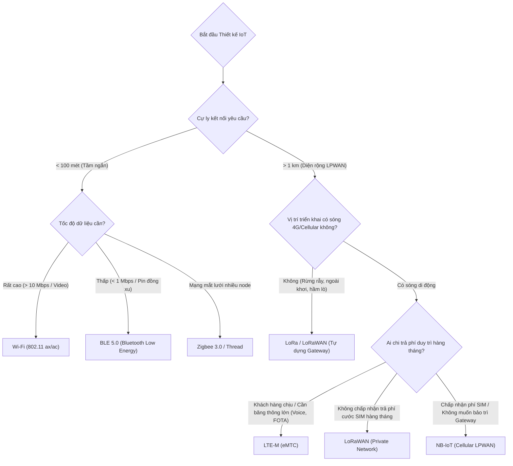

# Bài 03: So Sánh LoRa/LoRaWAN Với Wi-Fi, BLE, Zigbee, NB-IoT và LTE-M

> **Chuyên mục:** LoRa & LoRaWAN — Từ Nền Tảng Đến Ứng Dụng Thực Chiến  
> **Tác giả:** Kỹ sư Nghiên cứu Embedded-AIoT Lab PTIT  
> **Thời gian đọc:** 17 phút  
> **Trạng thái xác thực:** Phân tích Dữ liệu Đo kiểm Năng lượng & Băng thông Chuẩn Công Nghiệp  

---

## 1. Giới thiệu (Introduction)

Khi bắt tay vào giai đoạn thiết kế ý tưởng (Concept Design) của một thiết bị IoT, quyết định lựa chọn **Giao thức Kết nối Không dây (Wireless Connectivity Technology)** là một trong những quyết định kỹ thuật mang tính chiến lược sống còn. Chọn sai công nghệ có thể dẫn tới những hậu quả nghiêm trọng:
- Thiết bị hết pin sau vài tuần thay vì 5 năm như cam kết.
- Tầm phủ sóng bị chặn bởi vật cản, mất kết nối liên tục trong môi trường công nghiệp.
- Chi phí bảo trì, cước viễn thông hàng tháng (SIM Data) vượt quá giá trị kinh tế mà giải pháp mang lại.

Thị trường vô tuyến IoT hiện nay bị phân mảnh với hàng loạt chuẩn truyền thông: từ các công nghệ vô tuyến tầm ngắn (Short-range) như **Wi-Fi, Bluetooth Low Energy (BLE), Zigbee**, cho đến các giải pháp mạng di động diện rộng có cấp phép (Cellular Licensed LPWAN) như **NB-IoT, LTE-M (eMTC)**, và chuẩn phi cấp phép diện rộng nổi bật nhất là **LoRa / LoRaWAN**.

Không có công nghệ nào là "hoàn hảo cho mọi tình huống". Mỗi công nghệ đều được sinh ra để tối ưu hóa một tập hợp các ràng buộc kỹ thuật riêng biệt. Bài viết này sẽ phân tích chi tiết, khách quan ma trận tương quan giữa 6 công nghệ kết nối phổ biến nhất, cung cấp công thức định lượng tuổi thọ pin và tổng chi phí sở hữu (TCO), giúp kỹ sư đưa ra quyết định phần cứng chuẩn xác nhất.

---

## 2. Mục tiêu học tập (Learning Objectives)

Sau bài học này, kỹ sư sẽ:
- **Nắm vững ma trận so sánh:** Phân tích điểm mạnh, điểm yếu và giới hạn vật lý của 6 công nghệ: LoRaWAN, NB-IoT, LTE-M, Zigbee, Wi-Fi và BLE.
- **Tính toán năng lượng tiêu thụ:** Thiết lập công thức định lượng điện năng tiêu hao trên mỗi gói tin truyền ($E_{tx}$) và dự đoán chính xác tuổi thọ pin (Battery Lifetime) theo dung lượng danh định.
- **Đánh giá chi phí sở hữu (TCO):** So sánh mô hình chi phí đầu tư ban đầu (CAPEX) và chi phí vận hành hàng tháng (OPEX) giữa mạng riêng (Private LoRaWAN) và mạng di động công cộng (Cellular NB-IoT).
- **Phân loại ứng dụng chuẩn xác:** Lựa chọn đúng công nghệ vô tuyến cho từng miền ứng dụng: Nông nghiệp công nghệ cao, Công tơ điện nước thông minh (Smart Metering), Theo dõi tài sản (Asset Tracking), Nhà thông minh (Smart Home) và Giám sát máy móc công nghiệp (Predictive Maintenance).

---

## 3. Điều kiện tiên quyết (Prerequisites)

- Hiểu biết cơ bản về các định luật điện học: Điện tích ($Q = I \times t$, đơn vị mAh), Điện năng ($E = U \times I \times t$, đơn vị Joules hoặc mWh).
- Nắm vững các khái niệm về băng tần: Băng tần ISM không cấp phép (2.4 GHz, 868/915 MHz) và Băng tần viễn thông được cấp phép (Licensed Cellular Bands).
- Kiến thức cơ bản về mô hình truyền tin: Client-Server, Peer-to-Peer, Mesh Network.

---

## 4. Lý thuyết nền tảng & Bảng so sánh tổng hợp (Theory & Comparison Matrix)

Dưới đây là bảng tổng hợp các thông số kỹ thuật cốt lõi được trích xuất từ các chuẩn công nghiệp IEEE, 3GPP và LoRa Alliance:

| Tiêu chí Kỹ thuật | LoRa / LoRaWAN | NB-IoT (3GPP Rel 13/14) | LTE-M (Cat-M1) | BLE 5.0 (IEEE 802.15.1) | Zigbee 3.0 (IEEE 802.15.4) | Wi-Fi 6 (IEEE 802.11ax) |
| :--- | :--- | :--- | :--- | :--- | :--- | :--- |
| **Băng tần hoạt động** | Sub-GHz ISM (868/915/923 MHz) | Cellular Sub-GHz (B3, B5, B8, B20, B28...) | Cellular Sub-GHz / Mid-band | 2.4 GHz ISM | 2.4 GHz ISM (hoặc 868/915 MHz) | 2.4 GHz & 5 GHz (Wi-Fi 6E có 6 GHz) |
| **Bản quyền phổ tần** | **Miễn phí** (Unlicensed ISM) | **Có cấp phép** (Licensed Telecom) | **Có cấp phép** (Licensed Telecom) | **Miễn phí** (Unlicensed) | **Miễn phí** (Unlicensed) | **Miễn phí** (Unlicensed) |
| **Cự ly liên lạc tối đa** | **10 - 15+ km** (Ngoại thành), **2-5 km** (Đô thị) | **5 - 10 km** | **5 - 10 km** | 10 - 50 mét | 10 - 100 mét (mở rộng qua Mesh) | 30 - 100 mét |
| **Tốc độ truyền dữ liệu** | 0.3 kbps – 50 kbps | ~26 kbps (Rel 13) đến ~120 kbps (Rel 14) | 300 kbps – 1 Mbps | 1 Mbps – 2 Mbps | 250 kbps | 10 Mbps – 1.2+ Gbps |
| **Độ nhạy máy thu ($S$)** | **Xuống tới -137 đến -141 dBm** | ~ -128 dBm | ~ -120 dBm | ~ -95 dBm | ~ -100 dBm | ~ -85 dBm |
| **Dòng đỉnh phát (TX Peak)** | **20 - 45 mA** (tại +14 đến +22 dBm) | **120 - 250 mA** (tại +23 dBm) | **150 - 350 mA** (tại +23 dBm) | 5 - 15 mA (tại 0 đến +4 dBm) | 15 - 30 mA (tại +3 dBm) | **150 - 400 mA** |
| **Dòng khi ngủ (Deep Sleep)**| **1.0 - 1.8 $\mu\text{A}$** | 3 - 5 $\mu\text{A}$ (chế độ PSM) | 5 - 10 $\mu\text{A}$ (chế độ PSM) | 1 - 2 $\mu\text{A}$ | 1 - 3 $\mu\text{A}$ | 10 - 50 $\mu\text{A}$ |
| **Thời lượng pin dự kiến** | **5 - 10+ năm** (Pin 3.6V 2400mAh) | 3 - 7 năm | 1 - 3 năm | 1 - 3 năm (Pin đồng xu CR2032) | 1 - 3 năm (Pin 2x AAA) | Vài ngày đến vài tuần (cần sạc lại) |
| **Kiến trúc mạng** | Star-of-Stars (Trạm Gateway) | Star (Trạm phát sóng BTS nhà mạng) | Star (Trạm BTS nhà mạng) | P2P / Star / BLE Mesh | Mesh Network (Mạng mắt lưới) | Star (Access Point) |
| **Khả năng tự lập mạng riêng**| **Tuyệt đối 100%** (Tự dựng Gateway) | **Không thể** (Phụ thuộc nhà mạng) | **Không thể** (Phụ thuộc nhà mạng) | Có thể | Có thể | Có thể |
| **Cước phí duy trì SIM** | **0 VNĐ / tháng** | 10.000 – 30.000 VNĐ / SIM / tháng | 25.000 – 60.000 VNĐ / SIM / tháng | 0 VNĐ | 0 VNĐ | 0 VNĐ (sử dụng Internet cáp sẵn có) |

---

## 5. Phân tích kỹ thuật chuyên sâu (Technical Deep Dive)

### 5.1. So sánh Cặp đấu Kinh điển: LoRaWAN vs NB-IoT
Trong nhóm mạng diện rộng LPWAN, **LoRaWAN** và **NB-IoT (Narrowband IoT)** là hai đối thủ trực tiếp tranh giành ngôi vương:

#### 1. Sự khác biệt về Tần số và Băng thông:
- **LoRaWAN:** Sử dụng phổ tần ISM không cần giấy phép (Unlicensed). Băng thông điển hình là $125 \text{ kHz}$ hoặc $250 \text{ kHz}$. Vì là phổ tần mở, các thiết bị phải tuân thủ nghiêm ngặt quy định về **Duty Cycle** (tỷ lệ chiếm dụng kênh thường dưới $1\%$ tại Châu Âu, tức là mỗi thiết bị chỉ được phát tối đa 36 giây trong 1 giờ) hoặc phải áp dụng cơ chế nghe trước khi nói (Listen Before Talk - LBT).
- **NB-IoT:** Sử dụng dải tần số của nhà mạng di động (Licensed LTE spectrum) với băng thông hẹp đúng $180 \text{ kHz}$ (tương đương đúng 1 khối tài nguyên PRB trong khung LTE). Do sử dụng tần số có bản quyền, NB-IoT hoàn toàn không chịu can nhiễu từ các thiết bị ngoại lai và không bị hạn chế bởi quy định Duty Cycle.

#### 2. Kiến trúc Hạ tầng và Quyền Tự chủ:
- **Với LoRaWAN:** Doanh nghiệp có thể tự mua một bộ Gateway (như SX1302 Concentrator giá ~100-200 USD), gắn anten lên nóc nhà máy và tự vận hành một mạng viễn thông riêng biệt (Private LoRaWAN Network). Toàn bộ dữ liệu đi thẳng vào máy chủ nội bộ (On-premises ChirpStack Server) mà không cần đi qua Internet công cộng, đáp ứng tiêu chuẩn an toàn bảo mật cấp cao của ngành quân sự, dầu khí hoặc lưới điện.
- **Với NB-IoT:** Bạn không thể tự dựng trạm phát sóng nếu không phải là nhà mạng viễn thông (Viettel, VNPT, Mobifone). Mọi thiết bị bắt buộc phải gắn SIM, đăng ký gói cước và hoàn toàn phụ thuộc vào vùng phủ sóng của nhà mạng. Nếu một trạm đo nằm ở vùng trũng núi non không có sóng di động, thiết bị NB-IoT hoàn toàn tê liệt.

### 5.2. Mô hình Toán học Tính toán Năng lượng và Tuổi thọ Pin
Điện lượng tiêu hao tổng cộng $Q_{total}$ của một nút cảm biến trong một chu kỳ làm việc $T_{cycle}$ (ví dụ mỗi giờ thức dậy phát 1 lần) được xác định bằng:

$$Q_{cycle} = Q_{sleep} + Q_{sense} + Q_{tx} + Q_{rx}$$

Trong đó:
- $Q_{sleep} = I_{sleep} \times (T_{cycle} - T_{active})$: Năng lượng rò rỉ trong trạng thái ngủ sâu.
- $Q_{sense} = I_{sense} \times T_{sense}$: Năng lượng cấp cho cảm biến để đọc dữ liệu.
- $Q_{tx} = I_{tx} \times T_{tx}$: Năng lượng phát sóng vô tuyến ($T_{tx}$ chính là $ToA$).
- $Q_{rx} = I_{rx} \times T_{rx}$: Năng lượng mở bộ thu để chờ gói tin xác nhận hoặc nhận lệnh.

Tuổi thọ pin dự kiến tính theo năm ($Years$):

$$\text{Lifetime} = \frac{C_{battery} \times (1 - \text{Self\_Discharge})}{Q_{cycle} \times N_{cycles\_per\_year} \times \frac{1}{3600 \times 1000}}$$

*(với $C_{battery}$ tính bằng mAh, các $Q$ tính bằng mA.s, tỷ lệ tự suy hao của pin LiSOCl2 khoảng 1%/năm).*

---

## 6. Kiến trúc & Sơ đồ Kỹ thuật (Architecture & Diagrams)

Sơ đồ trực quan biểu diễn tương quan giữa các công nghệ không dây theo cự ly và tốc độ dữ liệu:

<div class="my-8 text-center">
  
  <p class="text-xs text-text-muted mt-2 font-mono">Hình 3.1: Không gian thiết kế tương quan giữa Băng thông và Cự ly truyền dẫn của các chuẩn kết nối không dây.</p>
</div>

### Cây Quyết Định Lựa Chọn Công Nghệ (Design Decision Tree):



---

## 7. Bài toán kỹ thuật thực tế (Worked Example)

### Bài toán Thiết kế:
Một dự án giám sát 1.000 đồng hồ nước thông minh tại một khu đô thị mới. Cứ mỗi **2 giờ**, mỗi đồng hồ thức dậy phát một gói tin **16 bytes** chỉ số nước về máy chủ. Mạch sử dụng một cell pin **LiSOCl2 SAFT LS14500 (Dung lượng danh định 2600 mAh, điện áp 3.6V)**.

Hãy so sánh điện năng tiêu hao và tuổi thọ pin giữa hai giải pháp:
- **Phương án A: Sử dụng LoRaWAN Class A (Chip Semtech SX1262)**
  - Cấu hình: SF8, BW 125 kHz, $P_{TX} = +14 \text{ dBm}$.
  - Dòng phát $I_{TX} = 25 \text{ mA}$, thời gian phát $T_{TX} = 100 \text{ ms} = 0.1 \text{ s}$.
  - Thời gian nghe 2 cửa sổ $T_{RX} = 20 \text{ ms}$, dòng nghe $I_{RX} = 5 \text{ mA}$.
  - Dòng ngủ sâu $I_{sleep} = 1.5 \ \mu\text{A} = 0.0015 \text{ mA}$.
- **Phương án B: Sử dụng NB-IoT (Module Quectel BC660K)**
  - Chế độ PSM (Power Saving Mode): Dòng ngủ $I_{sleep} = 3.5 \ \mu\text{A} = 0.0035 \text{ mA}$.
  - Quá trình thức dậy đồng bộ mạng và phát bản tin CoAP: Dòng phát trung bình $I_{TX} = 100 \text{ mA}$, thời gian kéo dài $T_{active} = 4 \text{ giây}$ (do phải đồng bộ lại tín hiệu LTE với tháp trạm BTS).

### Lời giải định lượng:

#### Với Phương án A (LoRaWAN):
1. **Điện lượng cho 1 lần phát (Uplink + RX window):**
   $$Q_{active} = (25 \text{ mA} \times 0.1 \text{ s}) + (5 \text{ mA} \times 0.02 \text{ s}) = 2.5 + 0.1 = 2.6 \text{ mA.s}$$
2. **Điện lượng tiêu hao khi ngủ trong chu kỳ 2 giờ (7200 giây):**
   $$Q_{sleep} = 0.0015 \text{ mA} \times (7200 - 0.12) \text{ s} \approx 10.79 \text{ mA.s}$$
3. **Tổng điện lượng tiêu hao trong 1 chu kỳ 2 giờ:**
   $$Q_{cycle\_LoRa} = 2.6 + 10.79 = 13.39 \text{ mA.s}$$
4. **Điện năng tiêu hao trong 1 năm ($365 \times 12 = 4380$ chu kỳ):**
   $$Q_{year} = 4380 \times 13.39 \text{ mA.s} = 58648.2 \text{ mA.s} = \frac{58648.2}{3600} \approx 16.29 \text{ mAh/năm}$$
5. **Tuổi thọ pin lý thuyết (tính cả 15% hao hụt do tự xả và trở kháng pin):**
   $$C_{eff} = 2600 \text{ mAh} \times 0.85 = 2210 \text{ mAh}$$
   $$\text{Tuổi thọ LoRaWAN} = \frac{2210 \text{ mAh}}{16.29 \text{ mAh/năm}} \approx \mathbf{135.6 \ \text{năm}} \to \text{Thực tế bị giới hạn bởi tuổi thọ hóa học của pin: } \mathbf{10 - 15 \ \text{năm}}.$$

#### Với Phương án B (NB-IoT):
1. **Điện lượng cho 1 lần kết nối và phát tin:**
   $$Q_{active} = 100 \text{ mA} \times 4.0 \text{ s} = 400 \text{ mA.s}$$
2. **Điện lượng tiêu hao khi ngủ PSM trong 7200 giây:**
   $$Q_{sleep} = 0.0035 \text{ mA} \times (7200 - 4.0) \text{ s} \approx 25.18 \text{ mA.s}$$
3. **Tổng điện lượng trong 1 chu kỳ 2 giờ:**
   $$Q_{cycle\_NBIoT} = 400 + 25.18 = 425.18 \text{ mA.s}$$
4. **Điện năng tiêu hao trong 1 năm:**
   $$Q_{year} = 4380 \times 425.18 \text{ mA.s} = 1862288.4 \text{ mA.s} = \frac{1862288.4}{3600} \approx 517.3 \text{ mAh/năm}$$
5. **Tuổi thọ pin lý thuyết:**
   $$\text{Tuổi thọ NB-IoT} = \frac{2210 \text{ mAh}}{517.3 \text{ mAh/năm}} \approx \mathbf{4.27 \ \text{năm}}.$$

> [!TIP]
> **Nhận xét cốt lõi:**
> Mặc dù NB-IoT hỗ trợ chế độ tiết kiệm năng lượng PSM rất tốt, nhưng do giao thức tầng mạng di động phức tạp (phải quét kênh tần số, thương lượng RRC Connection với trạm thu phát BTS của nhà mạng), thời gian hoạt động của máy phát kéo dài tới vài giây, khiến điện năng tiêu hao trên mỗi gói tin gấp **gần 30 lần** so với cơ chế ALOHA phát tức thì của LoRaWAN.

---

## 8. Thực hành mô phỏng năng lượng (Hands-on Lab)

Dưới đây là công cụ C thuần (`iot_battery_simulator.c`) giúp kỹ sư tính toán chính xác tuổi thọ pin dựa trên bảng thông số kỹ thuật thực tế của các dòng chip:

```c
/**
 * @file iot_battery_simulator.c
 * @brief Mô phỏng và So sánh Tuổi thọ Pin giữa LoRaWAN và NB-IoT
 * @author Embedded-AIoT Lab PTIT
 */

#include <stdio.h>
#include <stdint.h>

typedef struct {
    const char *name;
    double sleep_current_ua;   // Dòng ngủ (uA)
    double tx_current_ma;      // Dòng phát (mA)
    double tx_time_sec;        // Thời gian phát (s)
    double rx_current_ma;      // Dòng nhận (mA)
    double rx_time_sec;        // Thời gian nhận (s)
} radio_profile_t;

void simulate_lifespan(const radio_profile_t *prof, double battery_mah, double interval_minutes) {
    double interval_sec = interval_minutes * 60.0;
    
    // 1. Điện lượng tiêu hao trong 1 chu kỳ (mA.s)
    double q_sleep = (prof->sleep_current_ua / 1000.0) * (interval_sec - prof->tx_time_sec - prof->rx_time_sec);
    double q_tx = prof->tx_current_ma * prof->tx_time_sec;
    double q_rx = prof->rx_current_ma * prof->rx_time_sec;
    double q_cycle_mas = q_sleep + q_tx + q_rx;

    // 2. Số chu kỳ trong 1 năm
    double cycles_per_year = (365.25 * 24.0 * 3600.0) / interval_sec;
    double mah_per_year = (q_cycle_mas * cycles_per_year) / 3600.0;

    // 3. Tuổi thọ pin (trừ 15% tự xả)
    double usable_battery = battery_mah * 0.85;
    double years = usable_battery / mah_per_year;

    printf("[-] Công nghệ: %s\n", prof->name);
    printf("    |- Dòng tiêu thụ chu kỳ     : %.2f mA.s / lần phát\n", q_cycle_mas);
    printf("    |- Điện năng hao tổn 1 năm  : %.2f mAh / năm\n", mah_per_year);
    printf("    |- Tuổi thọ pin dự tính     : \033[1;32m%.2f năm\033[0m\n", years);
}

int main(void) {
    printf("===============================================================\n");
    printf("   EMBEDDED-AIOT LAB: BỘ MÔ PHỎNG NĂNG LƯỢNG THIẾT BỊ IOT     \n");
    printf("===============================================================\n\n");

    double battery_capacity = 2600.0; // Cell pin 2600 mAh LiSOCl2
    double interval = 120.0;          // Cứ 120 phút phát 1 lần

    printf("[i] Cấu hình: Pin = %.0f mAh, Chu kỳ truyền = %.0f phút\n\n", battery_capacity, interval);

    radio_profile_t lorawan = {
        .name = "LoRaWAN Class A (SX1262)",
        .sleep_current_ua = 1.5,
        .tx_current_ma = 25.0,
        .tx_time_sec = 0.10,
        .rx_current_ma = 5.0,
        .rx_time_sec = 0.02
    };

    radio_profile_t nbiot = {
        .name = "NB-IoT PSM (Quectel BC660K)",
        .sleep_current_ua = 3.5,
        .tx_current_ma = 100.0,
        .tx_time_sec = 4.0,
        .rx_current_ma = 0.0,
        .rx_time_sec = 0.0
    };

    simulate_lifespan(&lorawan, battery_capacity, interval);
    printf("---------------------------------------------------------------\n");
    simulate_lifespan(&nbiot, battery_capacity, interval);

    printf("===============================================================\n");
    return 0;
}
```

### Lệnh biên dịch và chạy thử nghiệm:
```bash
gcc -Wall -O2 iot_battery_simulator.c -o iot_battery_simulator
./iot_battery_simulator
```

---

## 9. Kiểm chứng & Đo kiểm (Verification)

Để kiểm chứng các thông số dòng tiêu thụ trong thực tế phòng Lab:
1. **Thiết bị đo kiểm:** Sử dụng thiết bị đo dòng chính xác cao chuyên dụng cho IoT như **Nordic Power Profiler Kit II (PPK2)** hoặc **Otii Arc**. Thiết lập chế độ đo Ampere Meter với tần số lấy mẫu $100 \text{ kS/s}$.
2. **Quan sát Profile dòng điện:**
   - Với LoRaWAN: Quan sát thấy một đỉnh phát nhọn duy nhất kéo dài ~100ms, theo sau bởi 2 đỉnh nhận tin rất nhỏ tương ứng với cửa sổ RX1 và RX2. Sau đó dòng rơi ngay lập tức xuống mức phẳng $1.5 \ \mu\text{A}$.
   - Với NB-IoT: Dòng điện dao động liên tục từ 50 mA đến 250 mA trong suốt 3-5 giây để hoàn tất thủ tục kết nối mạng di động.

---

## 10. Lỗi thường gặp & Xử lý sự cố (Troubleshooting)

| Sai lầm thiết kế | Hậu quả thực tế | Giải pháp khắc phục |
| :--- | :--- | :--- |
| **Dùng pin Alkaline cho thiết bị NB-IoT** | Thiết bị sập nguồn ngay khi vừa bật sóng phát. | Do nội trở của pin Alkaline quá cao ($R_{int} > 1\Omega$). Khi module NB-IoT kéo dòng đỉnh 250 mA, sụt áp vượt quá ngưỡng Brownout Reset của chip. **Bắt buộc dùng pin Li-SOCl2 hoặc mắc thêm tụ điện đệm (Supercapacitor > 100uF)**. |
| **Chọn Wi-Fi cho dự án chạy pin ngoài trời** | Pin 18650 dung lượng 3000 mAh cạn sạch chỉ sau chưa đầy 2 tuần. | Ngay cả khi ngủ, mạch Wi-Fi vẫn tiêu tốn dòng rò lớn và thời gian bắt tay DHCP/WPA2 kéo dài. Phải chuyển sang dùng LoRaWAN hoặc BLE kết hợp Gateway chuyển tiếp. |
| **Triển khai NB-IoT trong tầng hầm chung cư** | Thiết bị liên tục mất kết nối hoặc pin hết sau 6 tháng. | Trong tầng hầm kín (nhiều lớp bê tông cốt thép), sóng di động bị suy hao cực mạnh. Module NB-IoT buộc phải kích hoạt chế độ lặp gói tin (*Coverage Enhancement Level 2 - CE2*), khiến thời gian phát kéo dài gấp 10 lần và ngốn pin gấp 10 lần. Trong kịch bản này, đặt một Gateway LoRaWAN ngoài trời kéo anten cáp đồng trục vào hầm là giải pháp tối ưu. |

---

## 11. Câu hỏi phỏng vấn kỹ thuật (Interview Questions)

### Câu 1 (Cơ bản): Tại sao mạng Zigbee ít khi được ứng dụng trong nông nghiệp thông minh diện tích hàng trăm hecta?
*Trả lời:* Zigbee sử dụng băng tần 2.4 GHz với cự ly liên lạc giữa hai nút chỉ đạt khoảng 50 - 100 mét. Mặc dù Zigbee hỗ trợ kiến trúc mắt lưới (Mesh Network) cho phép các nút chuyển tiếp tin nhắn, nhưng trong nông nghiệp cánh đồng trống trải, mật độ nút cảm biến rất thưa thớt, không đủ số lượng nút trung gian để duy trì tuyến đường (Routing Path). Ngoài ra, các nút đóng vai trò Router trong mạng Mesh phải luôn bật bộ thu liên tục, khiến chúng không thể chạy bằng pin mà bắt buộc phải có nguồn điện liên tục.

### Câu 2 (Trung bình): Giải thích khái niệm "Coverage Enhancement (CE)" trong NB-IoT và sự đánh đổi của nó đối với năng lượng?
*Trả lời:* Khái niệm Coverage Enhancement (CE) trong chuẩn 3GPP cho phép trạm gốc và thiết bị NB-IoT lặp lại cùng một gói tin nhiều lần (lên tới 128 hoặc 2048 lần lặp lại) nhằm tích lũy năng lượng tín hiệu ở môi trường suy hao cực nặng (như tầng hầm, ống cống). Sự đánh đổi là thời gian phát sóng ($T_{active}$) tăng lên hàng chục giây, khiến điện năng tiêu hao tăng vọt theo cấp số nhân và làm giảm tuổi thọ pin từ nhiều năm xuống chỉ còn vài tháng.

### Câu 3 (Trung bình): Phân biệt mô hình chi phí CAPEX và OPEX giữa LoRaWAN và mạng di động Cellular?
*Trả lời:*
- **LoRaWAN:** Chi phí đầu tư ban đầu (**CAPEX**) cao hơn một chút vì doanh nghiệp phải mua sắm và lắp đặt các trạm thu Gateway. Tuy nhiên, chi phí vận hành hàng tháng (**OPEX**) xấp xỉ bằng **0 đồng**, vì sử dụng dải tần ISM miễn phí và không tốn cước viễn thông.
- **Cellular (NB-IoT / LTE-M):** Chi phí ban đầu (**CAPEX**) thấp vì tận dụng hạ tầng trạm phát sóng có sẵn của nhà mạng viễn thông. Ngược lại, chi phí vận hành (**OPEX**) kéo dài liên tục suốt vòng đời thiết bị (phải trả tiền cước dữ liệu hàng tháng cho từng SIM). Với quy mô 100.000 thiết bị, chi phí OPEX của mạng di động sẽ vượt xa chi phí mua sắm Gateway LoRaWAN chỉ sau 1 đến 2 năm.

### Câu 4 (Nâng cao): Khi nào bắt buộc phải chọn LTE-M thay vì LoRaWAN hay NB-IoT?
*Trả lời:* Bắt buộc chọn LTE-M trong 3 trường hợp chính:
1. Ứng dụng yêu cầu truyền giọng nói qua mạng (Voice over LTE - VoLTE), như các nút bấm cấp cứu khẩn cấp trên xe hoặc thang máy.
2. Thiết bị di chuyển tốc độ cao (Asset tracking trên đường cao tốc > 60 km/h) cần cơ chế chuyển vùng mượt mà không rớt gói (*Seamless Handover* giữa các trạm BTS).
3. Hệ thống đòi hỏi cập nhật firmware từ xa qua mạng (FOTA - Firmware Over-The-Air) thường xuyên với các file nhị phân dung lượng lớn (> 500 KB) mà băng thông hẹp của LoRaWAN hay NB-IoT không thể đáp ứng nổi.

### Câu 5 (Nâng cao): Wi-Fi HaLow (IEEE 802.11ah) có thể thay thế LoRaWAN trong tương lai được không? Tại sao?
*Trả lời:* Wi-Fi HaLow hoạt động ở dải tần sub-GHz (900 MHz) với cự ly liên lạc lên tới 1 km và băng thông từ 150 kbps đến hàng chục Mbps, là một đối thủ cạnh tranh đáng gờm. Tuy nhiên, nó khó thay thế hoàn toàn LoRaWAN trong các ứng dụng viễn trình cực đoan vì:
- Quỹ suy hao đường truyền (Link Budget) của Wi-Fi HaLow chỉ đạt ~125-130 dB, thấp hơn đáng kể so với mức >150 dB của LoRa CSS.
- Chip thu phát Wi-Fi HaLow có cấu trúc xử lý OFDM phức tạp, dòng điện tiêu thụ khi hoạt động lớn hơn nhiều so với LoRa.
- Hệ sinh thái phần cứng và độ phủ thị trường của LoRaWAN đã đi trước gần 10 năm với hàng triệu trạm Gateway được thương mại hóa trên toàn cầu.

---

## 12. Tổng kết & Bài học tiếp theo (Summary & Next Steps)

Lựa chọn công nghệ vô tuyến là nghệ thuật cân bằng giữa cự ly, năng lượng, băng thông và bài toán kinh tế:
- **LoRaWAN** là giải pháp tối ưu số 1 cho các cảm biến viễn trình diện rộng, chạy pin 5-10 năm, dữ liệu nhỏ và yêu cầu mạng riêng độc lập.
- **NB-IoT / LTE-M** thích hợp cho các khu vực đô thị có sẵn sóng di động và khách hàng chấp nhận chi trả chi phí thuê bao viễn thông hàng tháng.
- **Wi-Fi / BLE / Zigbee** thống trị tuyệt đối trong không gian nhà thông minh và mạng nội bộ cự ly ngắn.

Ở **Bài 04**, chúng ta sẽ lắp ghép toàn bộ các mảnh ghép để đi sâu vào **Kiến trúc Hệ thống Toàn trình End-to-End của LoRa/LoRaWAN**, theo dõi hành trình chi tiết của một gói dữ liệu từ cảm biến đầu cuối đi qua Gateway, Network Server cho đến ứng dụng Dashboard người dùng cuối.

---

## 13. Tài liệu tham khảo (References)

1. **LoRa Alliance**, *"LoRaWAN®: A Technical Overview of LoRa and LoRaWAN"*, White Paper, 2020.
2. **3GPP**, *"Release 13 Analytical Assessment: Cellular System Support for Ultra-Low Complexity and Low Throughput Internet of Things"*, TR 45.820.
3. **Nordic Semiconductor**, *"Power Consumption Comparison: LTE-M vs NB-IoT vs LoRa"*, White Paper, 2021.
4. **IEEE Standards Association**, *"IEEE 802.15.4: Low-Rate Wireless Networks"*, IEEE Standard for Information Technology.

