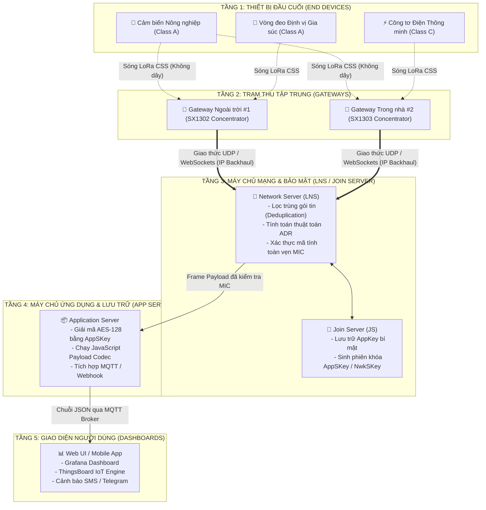
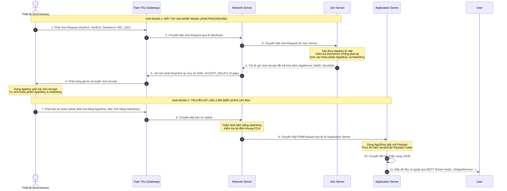

# Bài 04: Kiến Trúc Mạng Toàn Trình End-to-End LoRa/LoRaWAN: Từ Cảm Biến Đến Đám Mây

> **Chuyên mục:** LoRa & LoRaWAN — Từ Nền Tảng Đến Ứng Dụng Thực Chiến  
> **Tác giả:** Kỹ sư Nghiên cứu Embedded-AIoT Lab PTIT  
> **Thời gian đọc:** 18 phút  
> **Trạng thái xác thực:** Kiến trúc Thực nghiệm Chuẩn ChirpStack v4 & The Things Stack v3  

---

## 1. Giới thiệu (Introduction)

Trong kỹ thuật truyền thông không dây, việc một nút cảm biến phát thành công một tín hiệu RF ra không trung mới chỉ giải quyết được $20\%$ bài toán. $80\%$ khối lượng kỹ thuật còn lại nằm ở khả năng **vận chuyển, xác thực, định tuyến và giải mã dữ liệu một cách an toàn và tin cậy trên quy mô toàn mạng (End-to-End System Reliability)**.

Một hệ sinh thái LoRaWAN thương mại không bao giờ hoạt động theo kiểu "một thiết bị nói chuyện với một cổng thu duy nhất". Thay vào đó, nó vận hành dựa trên một kiến trúc phân tán hình sao kép (**Star-of-Stars Topology**) cực kỳ tinh vi:
- Hàng nghìn thiết bị đầu cuối (**End Devices**) phát sóng tự do vào không gian.
- Nhiều trạm thu tập trung (**Gateways**) trong tầm phủ sóng đồng thời thu nhận gói tin mà không cần bắt tay kết nối trước.
- Các Gateway đóng vai trò như những chiếc cầu nối "trong suốt" (Transparent Bridges), chuyển tiếp toàn bộ dữ liệu thô kèm thông tin chỉ thị chất lượng sóng (Metadata: RSSI, SNR, Timestamp) về một máy chủ trung tâm qua đường truyền IP/Ethernet/LTE.
- Máy chủ mạng (**LoRaWAN Network Server - LNS**) thực hiện lọc trùng lặp gói tin, xác thực danh tính, điều tiết thích ứng tham số vô tuyến và chuyển giao dữ liệu an toàn đến Máy chủ ứng dụng (**Application Server**) để hiển thị lên bảng điều khiển thời gian thực (Dashboard).

Bài viết này sẽ đưa kỹ sư vào một chuyến hành trình toàn cảnh theo dõi dòng chảy dữ liệu (Data Journey) xuyên suốt 5 khối chức năng của hệ thống LoRaWAN, giải mã các giao thức chuyển tiếp, cơ chế bảo mật kép và chuẩn hóa định dạng dữ liệu IoT.

---

## 2. Mục tiêu học tập (Learning Objectives)

Sau bài học này, bạn sẽ làm chủ:
- **Kiến trúc 5 khối chức năng:** Nắm vững vai trò, ranh giới và giao thức giao tiếp giữa: End Device $\to$ Gateway $\to$ Network Server (LNS) $\to$ Join Server (JS) $\to$ Application Server (AS).
- **Giao thức chuyển tiếp gói tin Gateway:** Phân biệt rõ cơ chế hoạt động của **Semtech UDP Packet Forwarder** cổ điển và giao thức hiện đại **Basic Station (LNS Protocol qua WebSockets)**.
- **Thuật toán lọc trùng lặp (Deduplication):** Hiểu cách thức Network Server xử lý khi một gói tin được thu nhận đồng thời bởi 3 đến 5 Gateway khác nhau.
- **Quy trình giải mã dữ liệu đầu cuối:** Nắm vững luồng giải mã dữ liệu nhị phân (Binary Hex Payload) thành đối tượng JSON có ý nghĩa thông qua hàm **JavaScript Payload Codec** (Decode/Encode).
- **Phát triển bộ giả lập Gateway chuyển tiếp:** Tự xây dựng chương trình C/Linux đóng gói khung tin vô tuyến và đính kèm thông tin đo đạc RF gửi về máy chủ mạng qua socket UDP.

---

## 3. Điều kiện tiên quyết (Prerequisites)

- Đã hoàn thành các bài học 01, 02 và 03 về tầng vật lý LoRa và tầng giao thức LoRaWAN.
- Hiểu biết cơ bản về giao thức mạng IP: Địa chỉ IPv4, Giao thức truyền dữ liệu không kết nối **UDP Socket**, và giao thức truyền thông điệp **MQTT**.
- Khái niệm cơ bản về lập trình JavaScript / TypeScript (hàm xử lý mảng byte và chuỗi JSON).

---

## 4. Lý thuyết nền tảng: Mô hình Hình Sao Kép (Star-of-Stars Topology)

Trái ngược hoàn toàn với mạng mắt lưới (Mesh Networks) vốn đòi hỏi các nút phải chuyển tiếp gói tin của nhau và gây tiêu hao pin lớn cho các nút trung gian, kiến trúc LoRaWAN áp dụng triệt để mô hình **Hình Sao Kép (Star-of-Stars)**:



### Nguyên lý Vận hành Đặc trưng của Kiến trúc:
1. **Không liên kết tĩnh giữa Thiết bị và Trạm thu (No Node-to-Gateway Association):**  
   Một thiết bị không "kết nối" (pair) riêng với bất kỳ Gateway cụ thể nào. Nó chỉ đơn giản phát gói tin vào không gian vô tuyến. Mọi Gateway nằm trong cự ly nghe thấy tín hiệu và giải mã thành công đều sẽ đóng gói gói tin đó kèm thông số đo đạc ($RSSI$, $SNR$) và đẩy lên Network Server qua đường truyền IP.
2. **Khả năng dung lỗi và Tiếp sóng đa hướng (Macro Diversity):**  
   Nếu một Gateway bị mất điện hoặc hỏng anten, các Gateway khác trong khu vực vẫn thu được gói tin bình thường mà không cần tái cấu hình thiết bị đầu cuối.

---

## 5. Phân tích kỹ thuật chuyên sâu (Technical Deep Dive)

Dưới đây là sơ đồ kiến trúc phân rã chi tiết toàn hệ thống theo chuẩn quốc tế LoRaWAN:

<div class="my-8 text-center">
  
  <p class="text-xs text-text-muted mt-2 font-mono">Hình 4.1: Luồng xử lý dữ liệu và cơ chế bảo mật phân lớp độc lập xuyên suốt mạng LoRaWAN.</p>
</div>

### 5.1. Khối Chức năng 1: Gateway và Giao thức Chuyển tiếp (Packet Forwarder)
Khác với router Wi-Fi thông thường (vốn có CPU mạnh xử lý định tuyến IP phức tạp), một LoRaWAN Gateway công nghiệp thực chất là một **bộ chuyển đổi tần số vô tuyến sang gói tin mạng (RF-to-IP Bridge)**.

Bên trong Gateway chứa một chip xử lý đa kênh băng cơ sở chuyên dụng như **Semtech SX1302** hoặc **SX1303**, có khả năng lắng nghe và giải mã đồng thời **8 đến 16 kênh tần số** ở tất cả các Spreading Factor (SF7 đến SF12).

#### Hai Giao thức Chuyển tiếp Gateway Phổ biến:
1. **Semtech UDP Packet Forwarder (Legacy):**
   - Sử dụng cổng UDP (mặc định `1700`) để đẩy gói tin JSON lên máy chủ (`PUSH_DATA`) và nhận lệnh xác nhận (`PUSH_ACK`).
   - *Ưu điểm:* Cực kỳ đơn giản, nhẹ tải, được hỗ trợ bởi hầu hết mọi Gateway đời cũ.
   - *Nhược điểm:* Sử dụng UDP không bảo mật, không có mã hóa TLS, dễ bị giả mạo IP (IP Spoofing) và dễ bị tường lửa doanh nghiệp chặn.
2. **Semtech Basic Station (Khuyến nghị hiện nay):**
   - Kết nối an toàn với Network Server thông qua **WebSockets bảo mật (WSS over TLS)**.
   - Hỗ trợ cơ chế xác thực chứng chỉ số (Mutual TLS / Client Certificates), tự động cập nhật cấu hình kênh truyền (Channel Plan) và cập nhật firmware Gateway từ xa thông qua giao thức CUPS (Configuration and Update Server).

### 5.2. Khối Chức năng 2: Network Server (LNS) và Thuật toán Lọc Trùng (Deduplication)
Khi nhiều Gateway cùng thu được một bản tin từ một End-Device, chúng đều chuyển tiếp gói tin đó về Network Server. Quá trình xử lý tại LNS diễn ra qua các bước nghiêm ngặt:

1. **Lọc trùng lặp gói tin (Deduplication Algorithm):**
   - LNS mở một cửa sổ thời gian trễ ngắn (thường là $100 \text{ ms} - 200 \text{ ms}$) kể từ khi nhận được bản sao đầu tiên của gói tin.
   - Nhận diện các bản sao có cùng bộ tham số: `DevAddr`, `FCnt`, `Payload CRC` và `MIC`.
   - Giữ lại gói tin duy nhất và tổng hợp danh sách các Gateway thu được kèm theo $RSSI$ và $SNR$.
2. **Chọn Gateway tốt nhất cho đường truyền xuống (Downlink Path Selection):**
   - Nếu máy chủ cần gửi phản hồi (ACK) hoặc gói tin Downlink trong cửa sổ RX1/RX2, LNS sẽ tính toán chọn ra **Gateway có tỷ số tín hiệu trên nhiễu ($SNR$) cao nhất** để phát sóng.
3. **Thuật toán thích ứng tốc độ dữ liệu (Adaptive Data Rate - ADR):**
   - LNS phân tích lịch sử $SNR$ của 20 gói tin gần nhất của thiết bị. Nếu nhận thấy thiết bị có chất lượng sóng rất mạnh (dư thừa Link Budget), LNS sẽ gửi lệnh `LinkADRReq` yêu cầu thiết bị tăng tốc độ dữ liệu (hạ từ SF12 xuống SF7) và giảm công suất phát sóng TX, giúp tiết kiệm triệt để năng lượng pin cho thiết bị.

### 5.3. Khối Chức năng 3 & 4: Join Server và Application Server
Sự an toàn tuyệt đối của LoRaWAN bắt nguồn từ **Kiến trúc Bảo mật Phân quyền Kép (Dual-Key Architecture)**:

- **Tầng Mạng (Network Security):**
  - Quản lý bởi **Join Server** và **Network Server**.
  - Sử dụng khóa mạng **`NwkSKey`** để tính toán và thẩm định mã toàn vẹn **MIC**.
  - Đảm bảo thiết bị kết nối vào mạng là thiết bị chính chủ, không bị giả mạo.
- **Tầng Ứng Dụng (Application Security):**
  - Quản lý riêng biệt tại **Application Server**.
  - Sử dụng khóa ứng dụng **`AppSKey`** để mã hóa khối AES-128 toàn bộ trường `FRMPayload`.
  - **Điểm đột phá:** Ngay cả nhà mạng vận hành Network Server cũng **hoàn toàn không thể đọc trộm được nội dung dữ liệu cảm biến bên trong**, vì `AppSKey` chỉ được chia sẻ duy nhất giữa End-Device và Application Server của khách hàng.

---

## 6. Luồng Dữ liệu Bắt tay OTAA (Sequence Diagram)

Quy trình kích hoạt mạng Over-the-Air Activation (OTAA) chuẩn quốc tế diễn ra như sau:



---

## 7. Bài toán kỹ thuật thực tế (Worked Example)

### Tình huống Kỹ thuật:
Một cảm biến môi trường truyền lên chuỗi dữ liệu nhị phân thô (Raw Payload) gồm 4 bytes:
`0x09 0xC4 0x1A 0x2B`

Theo tài liệu đặc tả của nhà sản xuất phần cứng:
- 2 bytes đầu (`0x09 0xC4`): Giá trị nhiệt độ môi trường, định dạng số nguyên có dấu 16-bit nhân với hệ số tỉ lệ $100$ (Scale factor: `0.01 °C`).
- 2 bytes sau (`0x1A 0x2B`): Giá trị độ ẩm tương đối, định dạng số nguyên không dấu 16-bit nhân với hệ số tỉ lệ $100$ (Scale factor: `0.01 %`).

**Yêu cầu:** Viết hàm giải mã Payload Codec chuẩn ChirpStack / The Things Stack bằng JavaScript và xác định giá trị đo đạc thực tế.

### Lời giải chi tiết:

**Bước 1: Tính toán thủ công giá trị nhiệt độ:**
- Byte cao: `0x09`, Byte thấp: `0xC4`.
- Ghép giá trị 16-bit (Big-Endian): `(0x09 << 8) | 0xC4 = 0x09C4 = 2500` (thập phân).
- Áp dụng hệ số tỉ lệ:
  $$\text{Nhiệt độ} = \frac{2500}{100} = \mathbf{25.00 \ ^\circ C}$$

**Bước 2: Tính toán thủ công giá trị độ ẩm:**
- Byte cao: `0x1A`, Byte thấp: `0x2B`.
- Ghép giá trị 16-bit (Big-Endian): `(0x1A << 8) | 0x2B = 0x1A2B = 6699` (thập phân).
- Áp dụng hệ số tỉ lệ:
  $$\text{Độ ẩm} = \frac{6699}{100} = \mathbf{66.99 \ \%}$$

**Bước 3: Viết hàm giải mã Payload Codec chuẩn (ChirpStack v4):**
```javascript
function decodeUplink(input) {
    var bytes = input.bytes;
    if (bytes.length < 4) {
        return {
            errors: ["Payload quá ngắn, yêu cầu tối thiểu 4 bytes!"]
        };
    }

    // Đọc số nguyên có dấu 16-bit cho nhiệt độ
    var rawTemp = (bytes[0] << 8) | bytes[1];
    if (rawTemp & 0x8000) {
        rawTemp = rawTemp - 0x10000; // Xử lý số âm bù 2
    }
    var temperature = rawTemp / 100.0;

    // Đọc số nguyên không dấu 16-bit cho độ ẩm
    var rawHum = (bytes[2] << 8) | bytes[3];
    var humidity = rawHum / 100.0;

    return {
        data: {
            temperature: temperature,
            humidity: humidity,
            unit: {
                temperature: "°C",
                humidity: "%"
            }
        }
    };
}
```

---

## 8. Thực hành lập trình (Hands-on Lab)

Dưới đây là chương trình C trên Linux (`mock_packet_forwarder.c`) đóng vai trò giả lập một Gateway thu nhận gói tin vô tuyến LoRa và đóng gói thành bản tin JSON chuẩn **Semtech UDP Packet Forwarder Protocol (RFC draft)** để gửi trực tiếp tới máy chủ ChirpStack hoặc The Things Stack đang lắng nghe tại cổng UDP 1700.

```c
/**
 * @file mock_packet_forwarder.c
 * @brief Chương trình Giả lập Chuyển tiếp Gói tin Gateway (Semtech UDP Protocol)
 * Hỗ trợ biên dịch chéo trên cả Linux và Windows (Winsock2)
 * @author Embedded-AIoT Lab PTIT
 */

#include <stdio.h>
#include <stdlib.h>
#include <string.h>
#include <time.h>

#ifdef _WIN32
    #include <winsock2.h>
    #include <ws2tcpip.h>
    #pragma comment(lib, "ws2_32.lib")
    typedef int socklen_t;
    #define close_socket(s) closesocket(s)
#else
    #include <unistd.h>
    #include <arpa/inet.h>
    #include <sys/socket.h>
    #define close_socket(s) close(s)
#endif

#define SERVER_IP "127.0.0.1"
#define SERVER_PORT 1700
#define PROTOCOL_VERSION 2
#define PKT_PUSH_DATA 0

// Hàm mã hóa Base64 đơn giản cho Payload
static const char b64_table[] = "ABCDEFGHIJKLMNOPQRSTUVWXYZabcdefghijklmnopqrstuvwxyz0123456789+/";
void base64_encode(const unsigned char *src, size_t len, char *out) {
    size_t i, j = 0;
    for (i = 0; i < len; i += 3) {
        uint32_t val = (src[i] << 16) + (((i + 1) < len ? src[i + 1] : 0) << 8) + (((i + 2) < len ? src[i + 2] : 0));
        out[j++] = b64_table[(val >> 18) & 0x3F];
        out[j++] = b64_table[(val >> 12) & 0x3F];
        out[j++] = (i + 1 < len) ? b64_table[(val >> 6) & 0x3F] : '=';
        out[j++] = (i + 2 < len) ? b64_table[val & 0x3F] : '=';
    }
    out[j] = '\0';
}

int main(void) {
    printf("===============================================================\n");
    printf("  EMBEDDED-AIOT LAB: GATEWAY PACKET FORWARDER SIMULATOR       \n");
    printf("===============================================================\n\n");

#ifdef _WIN32
    WSADATA wsaData;
    if (WSAStartup(MAKEWORD(2, 2), &wsaData) != 0) {
        printf("[!] WSAStartup thất bại.\n");
        return 1;
    }
#endif

    int sockfd;
    struct sockaddr_in servaddr;

    if ((sockfd = socket(AF_INET, SOCK_DGRAM, 0)) < 0) {
        perror("Tạo Socket thất bại");
        return 1;
    }

    memset(&servaddr, 0, sizeof(servaddr));
    servaddr.sin_family = AF_INET;
    servaddr.sin_port = htons(SERVER_PORT);
    servaddr.sin_addr.s_addr = inet_addr(SERVER_IP);

    // Gói tin vô tuyến mẫu thu được tại Anten (16 bytes)
    unsigned char lora_phy_packet[] = {
        0x40, 0x01, 0x02, 0x03, 0x04, 0x00, 0x01, 0x00,
        0x01, 0x09, 0xC4, 0x1A, 0x2B, 0xEF, 0xBE, 0xAD, 0xDE
    };
    char b64_payload[64];
    base64_encode(lora_phy_packet, sizeof(lora_phy_packet), b64_payload);

    // Xây dựng Header 12 bytes theo chuẩn Semtech UDP
    unsigned char buffer[1024];
    buffer[0] = PROTOCOL_VERSION;
    buffer[1] = 0xAA; // Token ngẫu nhiên (Random Token High)
    buffer[2] = 0x55; // Token ngẫu nhiên (Random Token Low)
    buffer[3] = PKT_PUSH_DATA;

    // 8 bytes Gateway EUI duy nhất (ví dụ: AA:55:5A:00:00:00:00:01)
    unsigned char gw_eui[8] = { 0xAA, 0x55, 0x5A, 0x00, 0x00, 0x00, 0x00, 0x01 };
    memcpy(&buffer[4], gw_eui, 8);

    // Xây dựng chuỗi JSON mang siêu dữ liệu đo đạc vô tuyến (Metadata)
    char json_payload[512];
    snprintf(json_payload, sizeof(json_payload),
             "{\"rxpk\":[{"
             "\"tmst\":%u,"
             "\"freq\":921.4,"
             "\"chan\":0,"
             "\"rfch\":0,"
             "\"stat\":1,"
             "\"modu\":\"LORA\","
             "\"datr\":\"SF10BW125\","
             "\"codr\":\"4/5\","
             "\"rssi\":-85,"
             "\"lsnr\":9.5,"
             "\"size\":%zu,"
             "\"data\":\"%s\""
             "}]}",
             (unsigned int)time(NULL), sizeof(lora_phy_packet), b64_payload);

    strcpy((char*)&buffer[12], json_payload);
    size_t total_packet_len = 12 + strlen(json_payload);

    printf("[+] Đang đẩy gói tin Gateway -> Server (%s:%d)...\n", SERVER_IP, SERVER_PORT);
    printf("[+] JSON Metadata:\n%s\n\n", json_payload);

    sendto(sockfd, (const char*)buffer, (int)total_packet_len, 0, (const struct sockaddr *)&servaddr, sizeof(servaddr));
    printf("[✔] Đã gửi thành công %zu bytes qua socket UDP!\n", total_packet_len);

    close_socket(sockfd);

#ifdef _WIN32
    WSACleanup();
#endif

    return 0;
}
```

### Cách biên dịch và kiểm tra:
```bash
gcc -Wall -O2 mock_packet_forwarder.c -o mock_packet_forwarder
./mock_packet_forwarder
```

---

## 9. Kiểm chứng & Đo kiểm (Verification)

Để kiểm chứng tính đồng bộ của toàn bộ luồng dữ liệu End-to-End:
1. **Kiểm tra tầng IP Backhaul bằng Wireshark:**  
   Bật bộ lọc `udp.port == 1700` trên card mạng kết nối Gateway. Quan sát các bản tin `PUSH_DATA` được đẩy từ địa chỉ IP của Gateway tới IP của Network Server, và bản tin `PUSH_ACK` phản hồi ngược lại. Kiểm tra trường `data` trong JSON có đúng là chuỗi Base64 đại diện cho khung tin LoRaWAN hay không.
2. **Kiểm tra tầng Ứng dụng bằng MQTT Client (Mosquitto / MQTTX):**  
   Đăng ký (Subscribe) vào topic sự kiện của máy chủ ChirpStack:
   `application/{application_id}/device/{dev_eui}/event/up`
   Khi thiết bị phát sóng, máy tính nhận được tức thì một chuỗi JSON chứa toàn bộ dữ liệu đã giải mã:
   ```json
   {
     "deduplicationId": "38a7c2e1-4567-4e9b-b9f1-abcdef123456",
     "deviceInfo": {
       "deviceName": "PTIT-Weather-Sensor",
       "devEui": "0102030405060708"
     },
     "object": {
       "temperature": 25.0,
       "humidity": 66.99
     },
     "rxInfo": [
       { "gatewayId": "aa555a0000000001", "rssi": -85, "snr": 9.5 }
     ]
   }
   ```

---

## 10. Lỗi thường gặp & Xử lý sự cố (Troubleshooting)

| Sự cố | Triệu chứng | Cách khắc phục |
| :--- | :--- | :--- |
| **Gateway hiển thị Offline trên giao diện Web LNS** | Đèn mạng trên Gateway vẫn sáng nhưng máy chủ ChirpStack báo "Never seen". | Do tường lửa (Firewall) chặn cổng UDP `1700`, hoặc sai IP máy chủ trong file cấu hình `local_conf.json` của Gateway. Sử dụng lệnh `tcpdump -i any port 1700` trên server để kiểm tra gói tin có chạm tới cổng mạng hay không. |
| **Gói tin bị hủy với mã lỗi `MIC mismatch`** | Gateway nhận được gói tin nhưng Network Server đánh cờ đỏ loại bỏ và không chuyển tiếp sang App Server. | Sai lệch khóa mạng `NwkSKey` (thường do gõ nhầm khi nhập tay ở chế độ ABP), hoặc số đếm khung `FCnt` bị desync vượt quá cửa sổ trượt cho phép (*Frame Counter Drift*). |
| **Giao diện hiển thị Payload thô, không giải mã thành nhiệt độ/độ ẩm** | MQTT trả về chuỗi Hex `09C41A2B` thay vì các trường JSON. | Chưa cấu hình bộ giải mã (Payload Codec) cho Device Profile tương ứng trên Application Server. Vào mục cấu hình thiết bị và dán hàm `decodeUplink()` vào phần Codec. |

---

## 11. Câu hỏi phỏng vấn kỹ thuật (Interview Questions)

### Câu 1 (Cơ bản): Gateway LoRaWAN có biết khóa giải mã `AppSKey` của thiết bị không? Tại sao?
*Trả lời:* **Hoàn toàn không**. Gateway LoRaWAN hoạt động như một bộ cầu nối trong suốt ở Tầng 1 và Tầng 2 (PHY-to-IP Bridge). Nó chỉ chuyển tiếp nguyên vẹn các byte nhị phân vô tuyến lên Network Server. Gateway hoàn toàn không lưu trữ bất kỳ khóa bảo mật nào (`AppKey`, `NwkSKey`, `AppSKey`). Điều này đảm bảo an ninh mạng tuyệt đối: ngay cả khi kẻ trộm đánh cắp một trạm Gateway treo ngoài cột điện, chúng cũng không thể khai thác được bất kỳ thông tin nhạy cảm nào của người dùng.

### Câu 2 (Trung bình): Tại sao nhiều Gateway cùng thu nhận một gói tin lại là một ưu điểm lớn thay vì gây xung đột mạng?
*Trả lời:* Đây là đặc tính ưu việt của kiến trúc **Macro Diversity** trong LoRaWAN. Vì thiết bị phát sóng không liên kết tĩnh với bất kỳ Gateway nào, việc nhiều Gateway cùng thu được gói tin sẽ:
1. Tăng xác suất truyền tin thành công gần như tuyệt đối (nếu một Gateway gặp nhiễu cục bộ hoặc bóng che khuất, các Gateway khác vẫn bắt được).
2. Network Server chịu trách nhiệm lọc trùng lặp bản sao chỉ trong vài phần trăm giây.
3. Dựa trên độ chênh lệch thời gian đến (Time Difference of Arrival - TDOA) của cùng một gói tin tại tối thiểu 3 Gateway có gắn GPS đồng bộ thời gian nano-giây, máy chủ có thể định vị tọa độ địa lý của thiết bị mà không cần gắn chip GPS tốn pin (LoRa Geolocation).

### Câu 3 (Trung bình): Nêu sự khác nhau căn bản giữa giao thức Semtech UDP Packet Forwarder và Basic Station?
*Trả lời:*
- **Semtech UDP Packet Forwarder:** Giao thức không trạng thái qua cổng UDP không mã hóa. Không có xác thực bảo mật hai chiều, dễ bị tấn công giả mạo nguồn phát, không có cơ chế quản trị Gateway từ xa.
- **Basic Station:** Giao thức chuẩn công nghiệp hiện đại hoạt động trên nền WebSockets bảo mật (WSS/TLS). Cho phép xác thực Gateway bằng chứng chỉ số X.509, hỗ trợ tập trung kênh truyền LNS và tự động cập nhật cấu hình/firmware qua máy chủ CUPS.

### Câu 4 (Nâng cao): Trong thủ tục OTAA, vai trò của `DevNonce` là gì và điều gì xảy ra nếu thiết bị phát lại một `DevNonce` đã sử dụng?
*Trả lời:* `DevNonce` là một số ngẫu nhiên (theo chuẩn LoRaWAN 1.0.2) hoặc số đếm tăng dần liên tục (theo chuẩn LoRaWAN 1.0.4) do thiết bị sinh ra và gửi kèm trong gói tin `Join-Request`. Join Server lưu trữ toàn bộ lịch sử các `DevNonce` đã từng ghi nhận từ thiết bị đó. Nếu nhận được một gói `Join-Request` có `DevNonce` đã từng xuất hiện, Join Server sẽ lập tức hủy bỏ gói tin đó mà không phản hồi. Cơ chế này nhằm triệt tiêu hoàn toàn nguy cơ kẻ gian bắt gói sóng và phát lại (Replay Attack) để chiếm quyền điều khiển phiên kết nối.

### Câu 5 (Nâng cao): Giải thích cách Network Server tính toán và thực thi thuật toán ADR (Adaptive Data Rate) cho thiết bị di chuyển chậm hoặc cố định?
*Trả lời:*
- Khi thiết bị bật cờ `ADR = 1` trong khung tin, Network Server sẽ thu thập lịch sử chất lượng sóng ($SNR$) của $N$ gói tin gần nhất (thường $N=20$).
- LNS lấy giá trị $SNR_{max}$ trong tập dữ liệu đó và so sánh với ngưỡng $SNR_{req}$ của Spreading Factor hiện tại, cộng thêm một biên độ dự phòng (*Margin*, thường là $10 \text{ dB}$).
- Số bước cải thiện khả dụng:
  $$\text{Steps} = \left\lfloor \frac{SNR_{max} - SNR_{req} - \text{Margin}}{3} \right\rfloor$$
- Nếu $\text{Steps} > 0$, LNS sẽ gửi lệnh `LinkADRReq` yêu cầu thiết bị: Trước tiên hạ $SF$ xuống mức thấp hơn để tăng tốc độ truyền và giảm thời gian chiếm sóng ($ToA$). Khi đã đạt $SF7$, nếu vẫn còn bước dư, LNS tiếp tục yêu cầu thiết bị hạ công suất phát ($P_{TX}$) từng nấc $3 \text{ dBm}$ cho đến khi tối ưu hoàn toàn.

---

## 12. Tổng kết & Bài học tiếp theo (Summary & Next Steps)

Kiến trúc mạng toàn trình LoRaWAN là sự kết tinh hoàn hảo giữa công nghệ vô tuyến tầm xa, hạ tầng chuyển tiếp IP linh hoạt và mô hình an ninh mật mã phân lớp độc lập. Việc nắm vững dòng chảy dữ liệu End-to-End từ cảm biến đến Dashboard là nền tảng cốt lõi giúp kỹ sư thiết kế, vận hành và xử lý sự cố các hệ sinh thái IoT hàng chục nghìn thiết bị một cách tự tin và chuyên nghiệp.

Với bài học này, chúng ta đã chính thức hoàn thành toàn bộ **Chương 01: Tổng Quan Về LoRa & LPWAN**.

Ở **Chương 02: Tầng Vật Lý LoRa & Bản Chất Vô Tuyến RF (Articles 05 – 10)**, chúng ta sẽ bước sang một cấp độ kỹ thuật sâu hơn: giải phẫu chi tiết lý thuyết điện từ trường, toán học điều chế Chirp, tính toán trực giao $SF7 - SF12$, giải mã Link Budget và mô hình suy hao truyền sóng trong thế giới thực.

---

## 13. Tài liệu tham khảo (References)

1. **LoRa Alliance**, *"LoRaWAN® 1.0.4 Specification Package (TS001-1.0.4)"*, Technical Specification, 2020.
2. **Semtech Corporation**, *"LoRa Basics™ Station Architecture and Protocol Definition"*, Developer Portal, 2023.
3. **ChirpStack Project**, *"ChirpStack Architecture, Gateway Bridge & Application Server Integration"*, Open-Source Documentation, 2024.
4. **The Things Industries**, *"Packet Forwarding, Deduplication, and End-to-End Security Architecture"*, TTS v3 Docs.
